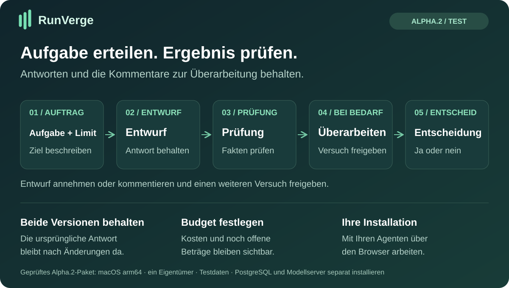
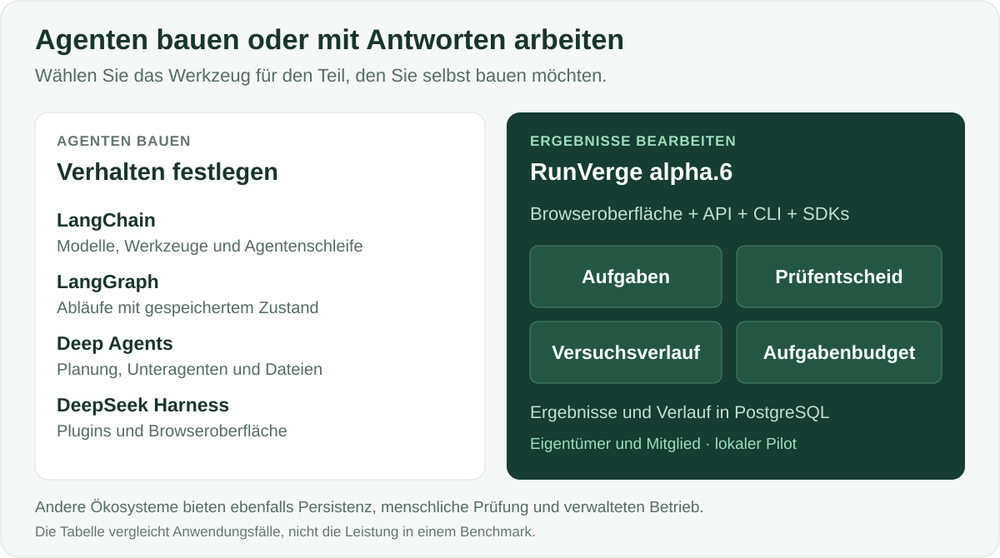

# RunVerge

**Agenten beauftragen, Antworten prüfen und Überarbeitungen nachvollziehen.**

[English](README.md) · [Русский](README.ru.md) · [Español](README.es.md) · [Português (Brasil)](README.pt-BR.md) · [Deutsch](README.de.md) · [Français](README.fr.md) · [简体中文](README.zh-CN.md)

RunVerge ist eine Anwendung für die Arbeit mit KI-Agenten. Beschreiben Sie Aufgabe und Budget, erhalten Sie einen Entwurf, kommentieren Sie ihn und entscheiden Sie über Annahme oder einen weiteren Versuch. Die ursprüngliche Antwort bleibt nach Änderungen verfügbar.

[**Loslegen →**](docs/QUICKSTART-ALPHA.md) · [**Alpha.6 herunterladen →**](https://github.com/ArtAndrew/RunVerge/releases/tag/0.14.0-alpha.6) · [**Erste Aufgabe →**](examples/alpha-first-task.md) · [**Feedback →**](https://github.com/ArtAndrew/RunVerge/issues/new/choose)

> **Experimentelle Alpha.6:** macOS arm64, lokaler Pilot mit Eigentümer und Mitglied und ausschließlich Testdaten. PostgreSQL 18 wird separat eingerichtet. Verwenden Sie ein lokales Modell oder OpenRouter. Vollständige Wiederherstellung, Updates bestehender Installationen und organisationsweiter Produktivbetrieb werden in dieser Version nicht unterstützt. [Unterstützter Umfang](docs/SUPPORT.md).

## Ein Team aus zwei Agenten ausprobieren

Ein Agent schreibt den Entwurf, ein zweiter prüft ihn, Sie entscheiden. Die bearbeitbare Vorlage bewahrt beide Antworten und nutzt ein gemeinsames Aufgabenbudget. Ein Kollege kann die Aufgabe mit eigenen lokalen Zugangsdaten starten; der Eigentümer kann Änderungen anfordern oder ein bestimmtes Ergebnis annehmen. Ein freigegebenes MCP-Leseergebnis kann in eine separat genehmigte Überarbeitung eingehen.

[Agentenanleitung auf Englisch](docs/TEAM-REVIEW.md) · [Zwei Benutzerkonten, auf Englisch](docs/TWO-PERSON-PILOT.md)

Auch der prüfende Agent kann erfundene Angaben übersehen. Eine unabhängige Freigabe ist nicht vorgeschrieben: Mitglieder können ihre eigene Arbeit annehmen. Alle Mitglieder können die Aufgaben der Organisation lesen. Verwenden Sie Testdaten; Remote-Teambetrieb und SSO werden nicht unterstützt.

## Wo RunVerge läuft und welches Modell es nutzt

RunVerge und das Modell sind getrennte Dienste. RunVerge speichert Aufgaben und Ergebnisse; das Modell erhält eine Anfrage und erzeugt eine Antwort. Die Engine enthält eine vom Administrator konfigurierbare HTTPS-Chat-Completions-Verbindung.

Das Alpha.6-Paket läuft auf macOS arm64 und enthält die Einrichtung lokaler Modelle sowie ein [Textprofil für OpenRouter](docs/OPENROUTER.md). Wählen Sie ein Modell, speichern Sie den Schlüssel privat und prüfen Sie den Entwurf. Das OpenRouter-Modell läuft beim Anbieter. Direkte Verbindungen zu DeepSeek, Nebius Token Factory und Z.ai sowie native Windows-/Linux-Pakete gehören nicht zu dieser Version. Ein geprüftes Modell belegt keine Kompatibilität mit allen Anbietern.

[OpenRouter ausprobieren](https://openrouter.ai/) · [Mit RunVerge verbinden](docs/OPENROUTER.md).

Auf `main` gibt es eine [aus dem Quellcode gebaute Vorschau für Linux-Server](docs/LINUX-SERVER.md), für neue Installationen mit Testdaten. Installation, separater Worker und Erhalt der Ergebnisse nach einem Neustart wurden auf Linux amd64 und arm64 geprüft. Die Vorschau ist vom Alpha.6-Download getrennt. Die Anleitung ist derzeit auf Englisch.

Anwendungshost und Modellanbieter sind getrennte Entscheidungen. Das aktuelle Mac-Paket bedeutet nicht, dass das Produkt nur lokale Modelle nutzen muss.

## Für wen ist RunVerge gedacht?

| Rolle | Bedarf | Heute ausprobieren |
|---|---|---|
| Entwickler einer KI-Anwendung | Ein Prüfablauf rund um die Agentenarbeit | Agenten und Aufgaben anlegen; Entwürfe und Versuche über Oberfläche, API oder SDK prüfen |
| Technischer Leiter | Nachvollziehen, was erstellt und entschieden wurde | Originalmaterialien, Feedback, Entscheidungen und Kostenstatus verfolgen |
| Früher Anwender mit Entwicklerunterstützung | Kurze Dokumente aus vorgegebenen Fakten erstellen | Text zusammenfassen, Anweisungen entwerfen oder Optionen vergleichen und das Ergebnis prüfen |

Beginnen Sie mit einem Eigentümer oder testen Sie die [lokale Anleitung für zwei Personen](docs/TWO-PERSON-PILOT.md) mit getrennten Zugangsdaten. Dies ist kein gemeinsam genutzter Produktivdienst.

## Praktische Vorteile

- **Zusammenhängender Ablauf:** Aufgabe, Entwurf, Feedback sowie Annahme oder Ablehnung in einer Anwendung.
- **Erhaltene Historie:** Getrennte Versuche behalten ihre Materialien; eine Korrektur ersetzt nicht das Original.
- **Bewusste Überarbeitung:** Änderungswünsche pausieren die Aufgabe. Ein weiterer Versuch erfordert eine separate Kostenzustimmung.
- **Klare Kostenaufzeichnungen:** Reservierungen, bestätigte Kosten und ungewisse Ergebnisse werden getrennt behandelt.
- **Lokales Modell:** Der Ablauf lässt sich ohne kostenpflichtige Modell-API erproben; Hardware und Strom bleiben Kostenfaktoren.
- **Integration:** API, CLI sowie Python- und TypeScript-SDKs verwenden gemeinsame öffentliche Verträge.

Nutzen Sie RunVerge, wenn Sie Aufgabenseiten mit gespeicherten Entwürfen, Prüfentscheidungen und Kostenaufzeichnungen benötigen. Ein allgemeiner Agenten-Harness ist ein anderer Ausgangspunkt: Er bietet mehr Kontrolle über das Verhalten des Agenten selbst.

## Vergleich mit anderen Werkzeugen

| Projekt | Schwerpunkt | Wann es passt |
|---|---|---|
| [LangChain](https://docs.langchain.com/oss/python/langchain/overview) | Modelle, Werkzeuge, Middleware und Agentenschleifen | Sie möchten das Agentenverhalten in Ihrer Anwendung zusammenstellen |
| [LangGraph](https://docs.langchain.com/oss/python/langgraph/overview) | Zustandsbehaftete Orchestrierung, dauerhafte Ausführung und menschliche Eingriffe | Sie benötigen eigene Graphen mit programmierten und modellgesteuerten Schritten |
| [Deep Agents](https://docs.langchain.com/oss/python/deepagents/overview) | Planung, Unteragenten, Dateikontext und Gedächtnis | Sie benötigen diese Fähigkeiten als Agentenbausteine |
| [DeepSeek Harness](https://github.com/deepseek-ai/deepseek-harness) | Durch Plugins erweiterbarer Harness mit Weboberfläche | Sie möchten den Harness über Plugins anpassen |
| **RunVerge alpha.6** | **Lokale Anwendung für Aufgaben und Ergebnisprüfung** | **Sie möchten diesen Ablauf mit getrennten lokalen Zugängen und Testdaten erproben** |

Die verlinkten offiziellen Beschreibungen wurden am 28. Oktober 2026 geprüft. Verglichen werden Ausgangspunkte, keine angeblich fehlenden Funktionen. LangGraph und Deep Agents unterstützen ebenfalls Persistenz und menschliche Eingriffe; das LangChain-Ökosystem bietet verwaltete Bereitstellungsprodukte. Vergleichende Belege für bessere Qualität, Geschwindigkeit, Sicherheit oder geringere Gesamtkosten von RunVerge liegen nicht vor.

## Ausführungs- und Kostenkontrolle

Budget, Versuchslimit und Frist begrenzen die Zulassung weiterer Arbeit. Sie garantieren weder sachliche Richtigkeit noch die endgültige Anbieterrechnung. Bei ungewissem Ausgang einer gesendeten Operation bleibt die Reservierung erhalten; es erfolgt keine blinde Wiederholung. Ein lokaler API-Tarif von null misst weder CPU/GPU, Strom noch Abschreibung und macht kostenpflichtige Werkzeuge nicht kostenlos.

**MCP:** Ein begrenztes [Beispiel zum Textlesen](docs/MCP-READ.md) bietet eine vertrauenswürdige Konfiguration, Berechtigungen und Ausführungsfreigabe. Beliebige Server, OAuth und ein allgemeiner Konnektorenkatalog gehören nicht zu Alpha.6.

## Ausprobieren

1. Folgen Sie dem [Schnellstart](docs/QUICKSTART-ALPHA.md), um Paket, PostgreSQL und Modell einzurichten.
2. Bearbeiten Sie die [erste Aufgabe](examples/alpha-first-task.md) mit fünf Beispielfakten.
3. Prüfen Sie den Entwurf, erfassen Sie eine Korrektur und genehmigen Sie einen weiteren Versuch separat.
4. Prüfen Sie beide Materialien und entscheiden Sie über die Annahme. Würden Sie mit einer zweiten Aufgabe zurückkommen?

**Alpha.6 bietet sieben Oberflächensprachen:** Englisch, Russisch, Spanisch, brasilianisches Portugiesisch, Deutsch, Französisch und vereinfachtes Chinesisch.

In Alpha.6 führt der Einstiegsleitfaden durch **Agentenentwurf speichern → Version veröffentlichen → Aufgabe erstellen und Antwort prüfen**. Optionale Anweisungen zur Arbeit mit bereitgestellten Texten und Aufgabenbeispiele füllen erst nach Ihrer Auswahl bearbeitbare Felder. Sie wählen kein Modell aus, veröffentlichen keinen Agenten und starten keine Arbeit automatisch.

Die Sprache wird in der oberen Leiste gewählt und auf diesem Gerät gespeichert. Ein Wechsel erhält Verbindung und laufende Arbeit; bereits eingegebene Aufgaben, Modellantworten und Materialien bleiben unverändert. Beträge bleiben exakte USD-Werte ohne Währungsumrechnung. [Sprachauswahl, lokale Dateien und Rückfallsprache](docs/LANGUAGES.md).

## Aktuelle Grenzen und Dokumentation

Ein Agent hat den Veröffentlichungsablauf geprüft; unabhängige Tests durch neue Anwender stehen noch aus. Ein kleines lokales Modell kann Fakten auslassen oder Antworten abschneiden. Bewahren Sie wichtige Ergebnisse außerhalb der Plattform auf.

Vollständige Wiederherstellung, Updates, Bedienbarkeit durch unabhängige Teams, der vollständige Unternehmens-SSO-Lebenszyklus, Cloud-Provider-Betrieb, beliebige MCP-Integrationen und Produktivlast sind nicht für Alpha.6 abgenommen. Stellen Sie die Installation nicht als öffentlichen Mehrbenutzerdienst bereit. Unter **Ergebnisse vergleichen** sehen Sie zwei genaue Versionen mit ihren Rückmeldungen. Mit **Als Vorlage für neue Aufgabe** wiederholen Sie eine abgeschlossene Aufgabe mit neuen Daten. [Anleitung auf Englisch](docs/REPEAT-WORK.md).

Pakete und SHA-256 stehen unter [Releases](https://github.com/ArtAndrew/RunVerge/releases). Eine Herausgebersignatur fehlt; die Prüfsumme bestätigt die Übereinstimmung mit dem veröffentlichten Wert, nicht die Identität des Herausgebers.

- [Installation](docs/NATIVE-BUNDLE.md) · [Modelle](docs/LOCAL-MODELS.md) · [MCP](docs/MCP-READ.md)
- [Versionshinweise](docs/RELEASE-NOTES-alpha.6.md) · [Unterstützung](docs/SUPPORT.md) · [Validierung](docs/VALIDATION-alpha.6.md)
- [Entwicklung](docs/DEVELOPMENT.md) · [API](contracts/README.md) · [öffentliche Inhalte](docs/PUBLIC-SOURCE.md)

[Feedback melden](https://github.com/ArtAndrew/RunVerge/issues/new/choose): Betriebssystem, Version und schwierigen Schritt angeben. Keine Tokens, privaten Einstellungen, Datenbankverbindungszeichenfolgen oder privaten Dokumente anhängen. Verlinkte Detailanleitungen können auf Englisch oder Russisch sein.

## Technik und Lizenzen

Server und Worker in Go, PostgreSQL, React/TypeScript-Workspace, Python- und TypeScript-SDKs. Der CLI-Befehl bleibt `platform`; interne Module heißen weiterhin `agent-platform`.

Server, CLI, Webanwendung, Dokumentation und Diagramme: [Elastic License 2.0](LICENSE). SDKs und Beispiele: Apache-2.0 gemäß den enthaltenen Lizenzdateien. Abhängigkeiten behalten ihre Lizenzen. ELv2 stellt den Quellcode bereit, ist aber keine von der OSI anerkannte Open-Source-Lizenz. [Lizenzgrenzen](docs/LICENSING.md).
