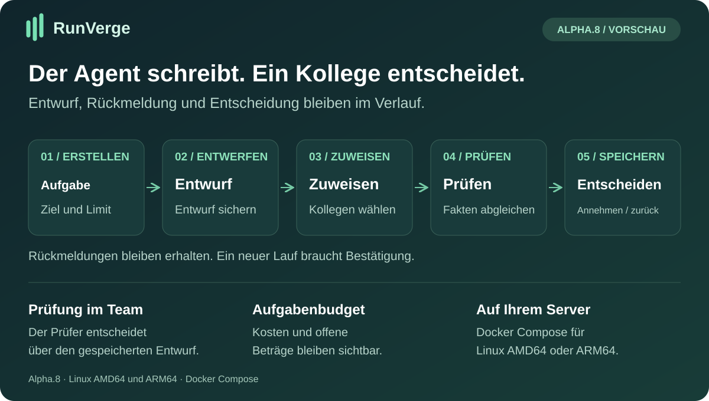
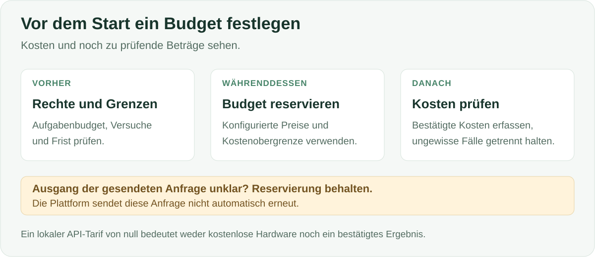
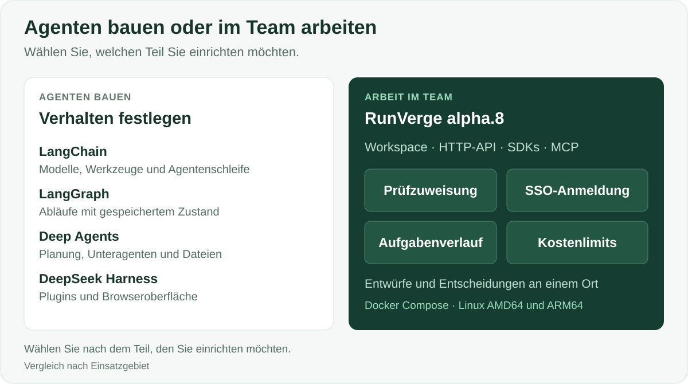

# RunVerge

**Ein selbst gehosteter Arbeitsbereich für Teams, die Agenten beauftragen und deren Ergebnisse prüfen.**

[**Alpha.8 · Downloads und Versionshinweise**](https://github.com/ArtAndrew/RunVerge/releases/tag/0.14.0-alpha.8) · [English](README.md) · [Русский](README.ru.md) · [Español](README.es.md) · [Português (Brasil)](README.pt-BR.md) · [Deutsch](README.de.md) · [Français](README.fr.md) · [简体中文](README.zh-CN.md)



Geben Sie dem Agenten eine Aufgabe und die Ausgangsmaterialien. Weisen Sie den gespeicherten Entwurf einem Kollegen zu. Unter **Mir zugewiesen** kann er ihn annehmen oder Änderungen anfordern. Entwurf und Entscheidung bleiben im Aufgabenverlauf.

## Installation unter Linux

Laden Sie AMD64 für Intel- oder AMD-Server herunter, für Arm-Server ARM64. Entpacken Sie das Paket und laden Sie das Docker-Image.

```sh
docker image load -i image.tar.gz
docker compose -f deploy/pilot.compose.yaml up --no-build --wait --wait-timeout 900
```

- **[Team-Pilot](docs/COMPOSE-PILOT.md)**. Docker Compose startet ein lokales CPU-Modell und legt ein Eigentümerkonto sowie zwei Mitglieder an. Nutzen Sie die Beispielaufgabe mit Testdaten.
- **[Anmeldung über die Organisation](docs/ORGANIZATION-COMPOSE.md)**. Nutzen Sie HTTPS und Ihren OpenID-Connect-Anbieter. Verknüpfen Sie jedes Unternehmenskonto mit einem RunVerge-Mitglied und vergeben Sie die passende Rolle.

Beim ersten Start lädt der lokale Pilot rund 1,12 GB Modellgewichte. Das HTTPS-Profil verwendet ein separat konfiguriertes Modell.

## Für wen eignet sich RunVerge?

Für Teams, die Ankündigungen oder Anleitungen erstellen, für Entwicklungsteams, die KI-Ergebnisse prüfen, und für Entwickler, die einen internen Arbeitsbereich mit API brauchen. Beginnen Sie mit einer wiederkehrenden Aufgabe, die Ihr Team bereits prüft.

## Was RunVerge festhält

- Der zugewiesene Prüfer entscheidet über einen gespeicherten Entwurf. Ein neuer Entwurf kann erneut zugewiesen werden.
- Änderungswünsche bleiben erhalten. Ein neuer Modelllauf erfordert eine separate Bestätigung.
- Das Aufgabenlimit, bestätigte Kosten und offene Beträge sind getrennt sichtbar. Prüfer gleichen den Entwurf mit den Quellen ab.



## Wie es sich in die Werkzeuglandschaft einfügt

LangChain, LangGraph, Deep Agents und DeepSeek Harness bieten Möglichkeiten, Agenten zu bauen und anzupassen. RunVerge bringt den Arbeitsbereich, die Prüfzuweisung, den Verlauf und die Linux-Installation für das Team mit.



## Schnittstellen für Entwickler

[HTTP-API](contracts/openapi.json) · [Python-SDK](packages/python-sdk) · [TypeScript-SDK](packages/typescript-sdk) · [MCP-Adapter](docs/MCP-ADAPTER.md)

Alpha.8 ist eine Vorschau für Neuinstallationen und Testdaten. Der SSO-Ablauf wurde mit einem isolierten Testanbieter geprüft. Das frühere Paket für macOS ARM64 finden Sie unter [alpha.7](https://github.com/ArtAndrew/RunVerge/releases/tag/0.14.0-alpha.7).

## Lizenz

Server und Weboberfläche verwenden ELv2. Client-SDKs und Beispiele verwenden Apache 2.0.
