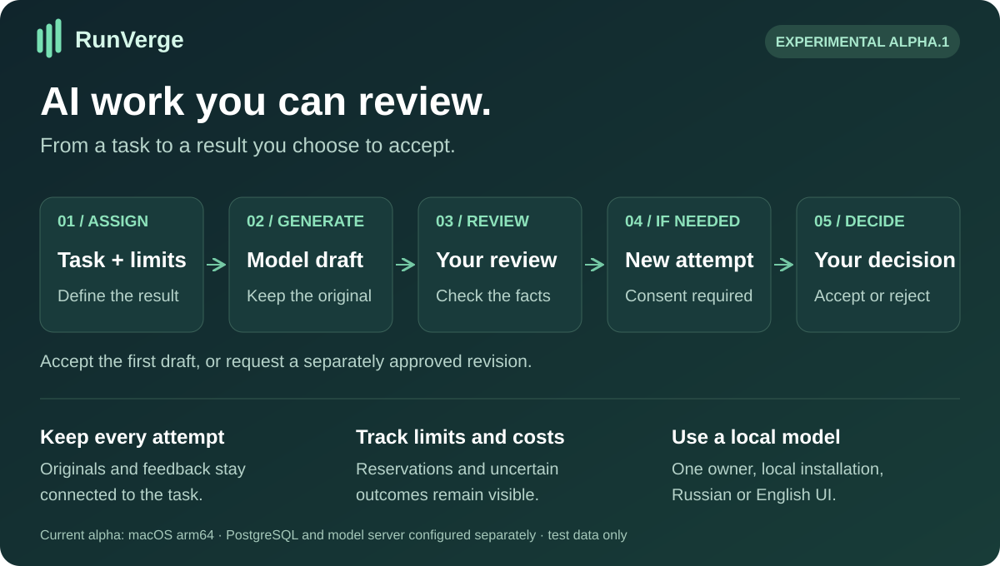
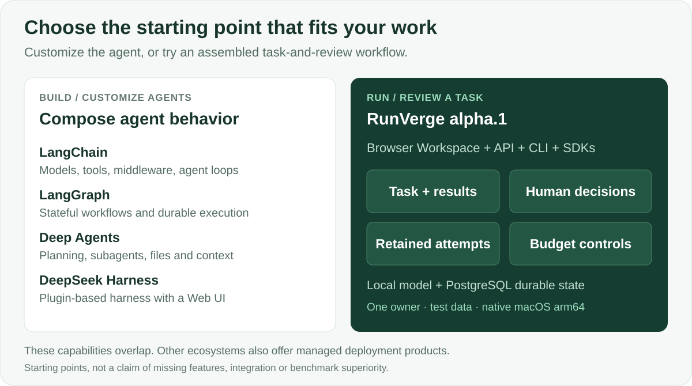
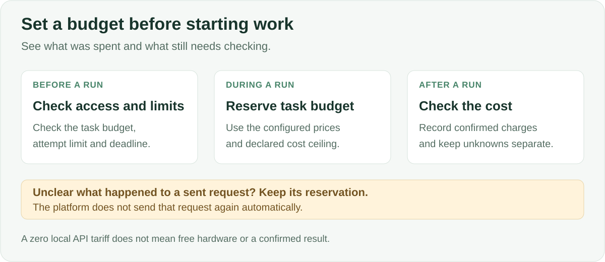

# RunVerge

**Un espacio de trabajo local para tareas de IA, borradores, decisiones humanas e historial de intentos.**

[English](README.md) · [Русский](README.ru.md) · [Español](README.es.md) · [Português (Brasil)](README.pt-BR.md) · [Deutsch](README.de.md) · [Français](README.fr.md) · [简体中文](README.zh-CN.md)

**Asigna una tarea. Comprueba el borrador. Pide una corrección. Conserva ambas versiones. Decide qué aceptar.** RunVerge reúne ese proceso en una aplicación con interfaz web, registros persistentes y controles de ejecución, sin tener que crear primero tu propia aplicación de revisión.

[**Empezar →**](docs/QUICKSTART-ALPHA.md) · [**Descargar alpha.1 →**](https://github.com/ArtAndrew/RunVerge/releases/tag/0.14.0-alpha.1) · [**Primera tarea →**](examples/alpha-first-task.md) · [**Comentarios →**](https://github.com/ArtAndrew/RunVerge/issues/new/choose)

> **Alpha.1 experimental:** macOS arm64, un único propietario local y solo datos de prueba. PostgreSQL 18 y el servidor local del modelo, como Ollama, se configuran por separado. Esta versión no admite restauración completa, actualizaciones de instalaciones existentes ni despliegue de producción para toda una organización. [Alcance compatible](docs/SUPPORT.md).

## ¿Para quién es?

| Perfil | Necesidad | Qué puedes probar hoy |
|---|---|---|
| Desarrollador de una aplicación de IA | Un flujo de revisión alrededor del agente | Crear tareas y agentes, inspeccionar borradores e intentos mediante la interfaz, API o SDK |
| Responsable técnico | Saber qué se produjo y qué se decidió | Seguir materiales originales, comentarios, decisiones y estado contable |
| Usuario inicial con ayuda de un desarrollador | Preparar documentos breves a partir de hechos aportados | Resumir un texto, redactar instrucciones o comparar opciones y revisar el resultado |

La instalación alpha admite **un propietario**; estos perfiles no implican un servicio compartido entre varios usuarios.

## Ventajas prácticas

- **Un flujo ya integrado:** tarea, borrador, comentarios y aceptación o rechazo en una aplicación.
- **Historial conservado:** cada intento mantiene su material; una corrección no sustituye el original.
- **Control de las revisiones:** solicitar cambios pausa la tarea. Iniciar otro intento requiere un consentimiento separado sobre el coste.
- **Contabilidad explícita:** reservas, gastos confirmados y resultados inciertos se distinguen.
- **Modelo local:** puedes probar el flujo sin una API de modelo de pago; el equipo y la energía siguen teniendo coste.
- **Integración:** API, CLI y SDK de Python y TypeScript comparten contratos públicos.

La ventaja de RunVerge es la combinación preparada para este caso de uso. Su alcance compatible sigue siendo más limitado que el de los ecosistemas consolidados.

## Comparación con otros instrumentos

| Proyecto | Enfoque principal | Cuándo elegirlo |
|---|---|---|
| [LangChain](https://docs.langchain.com/oss/python/langchain/overview) | Modelos, herramientas, middleware y bucles de agente | Quieres componer el agente dentro de tu propia aplicación |
| [LangGraph](https://docs.langchain.com/oss/python/langgraph/overview) | Orquestación con estado, ejecución duradera e intervención humana | Necesitas grafos personalizados con pasos programados y pasos del modelo |
| [Deep Agents](https://docs.langchain.com/oss/python/deepagents/overview) | Planificación, subagentes, contexto de archivos y memoria | Necesitas esas capacidades como base del agente |
| [DeepSeek Harness](https://github.com/deepseek-ai/deepseek-harness) | Harness extensible con plugins e interfaz web | Quieres personalizar el harness mediante plugins |
| **RunVerge alpha.1** | **Aplicación local de tareas y revisión** | **Quieres evaluar el flujo con un propietario y datos de prueba** |

Las descripciones oficiales enlazadas se revisaron el 28 de octubre de 2026. Esta comparación explica distintos puntos de partida, no funciones ausentes en otros proyectos. LangGraph y Deep Agents también ofrecen persistencia e intervención humana; el ecosistema LangChain dispone de productos de despliegue gestionado. No hay pruebas comparativas de que RunVerge sea superior en calidad, velocidad, seguridad o coste total.

## Límites de ejecución y costes

El presupuesto, el número de intentos y el plazo restringen la admisión de trabajo nuevo. No garantizan la exactitud del texto ni la factura final del proveedor. Una operación enviada con resultado incierto conserva su reserva y no se repite a ciegas. La tarifa local de API de cero no mide CPU/GPU, electricidad ni amortización, y no convierte en gratuitas las herramientas de pago.

**MCP:** hay un [ejemplo limitado de lectura de texto](docs/MCP-READ.md) con configuración de confianza, permisos y aprobación de ejecución. Servidores arbitrarios, OAuth y un catálogo general de conectores quedan fuera de alpha.1.

## Probar el flujo

1. Sigue el [inicio rápido](docs/QUICKSTART-ALPHA.md) para instalar y configurar PostgreSQL y el modelo.
2. Ejecuta la [primera tarea](examples/alpha-first-task.md) con cinco hechos de ejemplo.
3. Comprueba el borrador, registra una corrección y autoriza otro intento por separado.
4. Inspecciona ambos materiales y decide qué aceptar. Cuéntanos si volverías con otra tarea.

**La interfaz de alpha.1 solo está en inglés y ruso.** Los siete idiomas del README no son siete traducciones de la interfaz. Cambiar el idioma de la interfaz conserva la conexión y el trabajo actual; no traduce tareas ni respuestas. [Idiomas](docs/LANGUAGES.md).

## Límites actuales y documentación

Un agente comprobó el flujo de publicación; aún falta la evaluación independiente por nuevos usuarios. Un modelo local pequeño puede omitir hechos o truncar respuestas. Guarda los resultados importantes fuera de la plataforma.

Restauración completa, actualizaciones, uso en equipo, ciclo empresarial de SSO, despliegue para proveedores cloud, MCP arbitrario y rendimiento de producción no forman parte de la aceptación de alpha.1. No expongas la instalación como servicio público multiusuario. No hay comparación de versiones en paralelo; distingue los artefactos por ID y fecha.

[Releases](https://github.com/ArtAndrew/RunVerge/releases) contiene paquetes y SHA-256. No hay firma del editor; el checksum comprueba coincidencia con el valor publicado, no la identidad del editor.

- [Instalación](docs/NATIVE-BUNDLE.md) · [modelos](docs/LOCAL-MODELS.md) · [MCP](docs/MCP-READ.md)
- [Notas](docs/RELEASE-NOTES-alpha.1.md) · [soporte](docs/SUPPORT.md) · [validación](docs/VALIDATION-alpha.1.md)
- [Desarrollo](docs/DEVELOPMENT.md) · [API](contracts/README.md) · [contenido público](docs/PUBLIC-SOURCE.md)

[Envía comentarios](https://github.com/ArtAndrew/RunVerge/issues/new/choose) con sistema operativo, versión y paso problemático. No adjuntes tokens, configuración privada, cadenas de conexión ni documentos privados. Las guías detalladas enlazadas pueden estar en inglés o ruso.

## Tecnología y licencias

Servidor y workers en Go, PostgreSQL, Workspace React/TypeScript y SDK de Python y TypeScript. El comando CLI sigue siendo `platform`; los módulos internos conservan `agent-platform`.

Servidor, CLI, interfaz web, documentación y diagramas: [Elastic License 2.0](LICENSE). SDK y ejemplos: Apache-2.0 según sus licencias incluidas. Las dependencias conservan sus licencias. ELv2 permite acceso al código, pero no es una licencia de código abierto reconocida por OSI. [Límites de licencia](docs/LICENSING.md).
