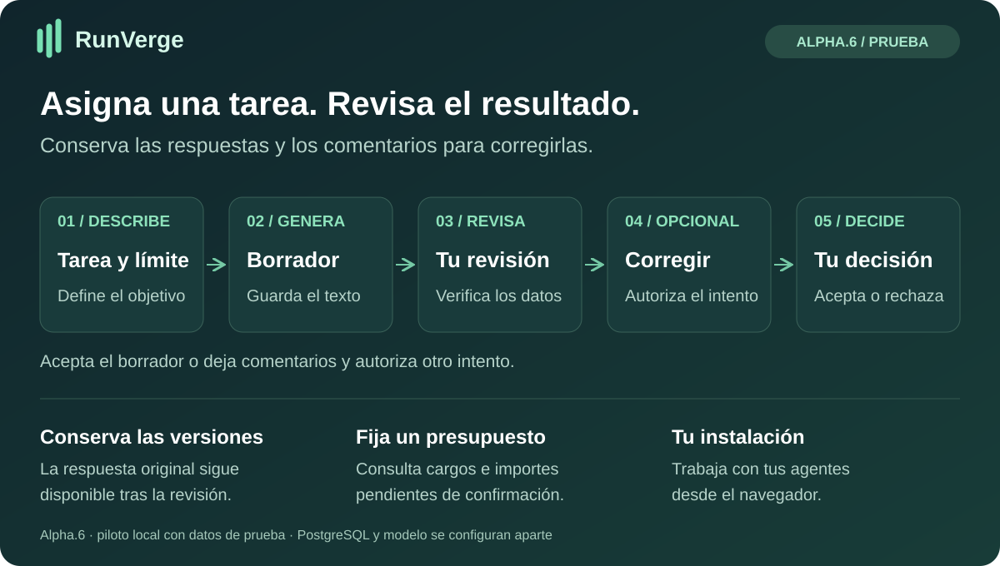
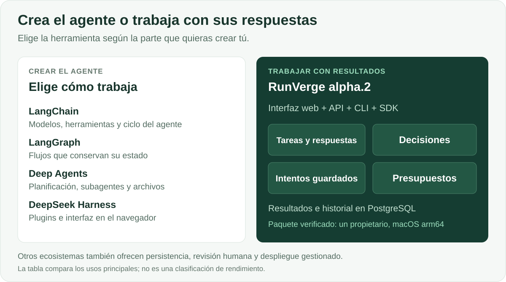

# RunVerge

**Asigna tareas a agentes, revisa sus respuestas y conserva el historial de cambios.**

[English](README.md) · [Русский](README.ru.md) · [Español](README.es.md) · [Português (Brasil)](README.pt-BR.md) · [Deutsch](README.de.md) · [Français](README.fr.md) · [简体中文](README.zh-CN.md)

RunVerge es una aplicación para trabajar con agentes de IA. Describe la tarea y su presupuesto, recibe un borrador, deja comentarios y decide si aceptas la respuesta o autorizas otro intento. La respuesta original sigue disponible después de las correcciones.

[**Empezar →**](docs/QUICKSTART-ALPHA.md) · [**Descargar alpha.4 →**](https://github.com/ArtAndrew/RunVerge/releases/tag/0.14.0-alpha.4) · [**Primera tarea →**](examples/alpha-first-task.md) · [**Comentarios →**](https://github.com/ArtAndrew/RunVerge/issues/new/choose)

> **Alpha.3 experimental:** macOS arm64, un único propietario local y solo datos de prueba. PostgreSQL 18 se configura por separado. Use un modelo local u OpenRouter. Esta versión no admite restauración completa, actualizaciones de instalaciones existentes ni despliegue de producción para toda una organización. [Alcance compatible](docs/SUPPORT.md).

## Dónde funciona RunVerge y qué modelo utiliza

RunVerge y el modelo son servicios separados. RunVerge guarda tareas y resultados; el modelo recibe una petición y genera una respuesta. El motor incluye una conexión HTTPS Chat Completions configurable por el administrador.

El paquete alpha.4 se ejecuta en macOS arm64 e incluye configuración de modelos locales y un [perfil de texto para OpenRouter](docs/OPENROUTER.md). Elija un modelo, guarde la clave de forma privada y revise el borrador. El modelo de OpenRouter se ejecuta en el proveedor. Las conexiones directas con DeepSeek, Nebius Token Factory y Z.ai y los paquetes nativos para Windows/Linux quedan fuera de esta versión. Verificar un modelo no demuestra compatibilidad con todos los proveedores.

[Probar OpenRouter](https://openrouter.ai/) · [Conectarlo a RunVerge](docs/OPENROUTER.md).

En `main` ya hay una [vista previa para servidores Linux compilada desde el código fuente](docs/LINUX-SERVER.md), para instalaciones nuevas con datos de prueba. En Linux amd64 y arm64 se verificaron la instalación, el trabajador separado y la conservación del resultado tras reiniciar. Es independiente de la descarga alpha.4. La guía está por ahora en inglés.

El equipo donde se instala la aplicación y el proveedor del modelo se eligen por separado. El paquete actual para Mac no significa que el producto deba usar solo modelos locales.

## ¿Para quién es?

| Perfil | Necesidad | Qué puedes probar hoy |
|---|---|---|
| Desarrollador de una aplicación de IA | Un flujo de revisión alrededor del agente | Crear tareas y agentes, inspeccionar borradores e intentos mediante la interfaz, API o SDK |
| Responsable técnico | Saber qué se produjo y qué se decidió | Seguir materiales originales, comentarios, decisiones y estado contable |
| Usuario inicial con ayuda de un desarrollador | Preparar documentos breves a partir de hechos aportados | Resumir un texto, redactar instrucciones o comparar opciones y revisar el resultado |

La instalación alpha admite **un propietario**; estos perfiles no implican un servicio compartido entre varios usuarios.

## Ventajas prácticas

- **Un flujo ya integrado:** tarea, borrador, comentarios y aceptación o rechazo en una aplicación.
- **Historial conservado:** cada intento mantiene su material; una corrección no sustituye el original.
- **Control de las revisiones:** solicitar cambios pausa la tarea. Iniciar otro intento requiere un consentimiento separado sobre el coste.
- **Contabilidad explícita:** reservas, gastos confirmados y resultados inciertos se distinguen.
- **Modelo local:** puedes probar el flujo sin una API de modelo de pago; el equipo y la energía siguen teniendo coste.
- **Integración:** API, CLI y SDK de Python y TypeScript comparten contratos públicos.

Usa RunVerge si necesitas páginas de tareas con borradores guardados, decisiones de revisión y registros de costes. Un harness general es otro punto de partida: ofrece más control sobre el comportamiento del propio agente.

## Comparación con otros instrumentos

| Proyecto | Enfoque principal | Cuándo elegirlo |
|---|---|---|
| [LangChain](https://docs.langchain.com/oss/python/langchain/overview) | Modelos, herramientas, middleware y bucles de agente | Quieres componer el agente dentro de tu propia aplicación |
| [LangGraph](https://docs.langchain.com/oss/python/langgraph/overview) | Orquestación con estado, ejecución duradera e intervención humana | Necesitas grafos personalizados con pasos programados y pasos del modelo |
| [Deep Agents](https://docs.langchain.com/oss/python/deepagents/overview) | Planificación, subagentes, contexto de archivos y memoria | Necesitas esas capacidades como base del agente |
| [DeepSeek Harness](https://github.com/deepseek-ai/deepseek-harness) | Harness extensible con plugins e interfaz web | Quieres personalizar el harness mediante plugins |
| **RunVerge alpha.4** | **Aplicación local de tareas y revisión** | **Quieres evaluar el flujo con un propietario y datos de prueba** |

Las descripciones oficiales enlazadas se revisaron el 28 de octubre de 2026. Esta comparación explica distintos puntos de partida, no funciones ausentes en otros proyectos. LangGraph y Deep Agents también ofrecen persistencia e intervención humana; el ecosistema LangChain dispone de productos de despliegue gestionado. No hay pruebas comparativas de que RunVerge sea superior en calidad, velocidad, seguridad o coste total.

## Límites de ejecución y costes

El presupuesto, el número de intentos y el plazo restringen la admisión de trabajo nuevo. No garantizan la exactitud del texto ni la factura final del proveedor. Una operación enviada con resultado incierto conserva su reserva y no se repite a ciegas. La tarifa local de API de cero no mide CPU/GPU, electricidad ni amortización, y no convierte en gratuitas las herramientas de pago.

**MCP:** hay un [ejemplo limitado de lectura de texto](docs/MCP-READ.md) con configuración de confianza, permisos y aprobación de ejecución. Servidores arbitrarios, OAuth y un catálogo general de conectores quedan fuera de alpha.4.

## Probar el flujo

1. Sigue el [inicio rápido](docs/QUICKSTART-ALPHA.md) para instalar y configurar PostgreSQL y el modelo.
2. Ejecuta la [primera tarea](examples/alpha-first-task.md) con cinco hechos de ejemplo.
3. Comprueba el borrador, registra una corrección y autoriza otro intento por separado.
4. Inspecciona ambos materiales y decide qué aceptar. Cuéntanos si volverías con otra tarea.

**Alpha.4 admite siete idiomas de interfaz:** inglés, ruso, español, portugués de Brasil, alemán, francés y chino simplificado.

En alpha.4, la guía inicial recorre **guardar un borrador de agente → publicar una versión → crear una tarea y revisar la respuesta**. Las instrucciones opcionales para trabajar con un texto fuente y los ejemplos de tareas solo rellenan campos editables cuando los eliges. No seleccionan un modelo, publican un agente ni inician trabajo automáticamente.

El idioma se elige en la barra superior y se guarda en este dispositivo. Cambiarlo conserva la conexión y el trabajo actual; los textos ya introducidos, las respuestas del modelo y los materiales no se traducen. Los importes siguen siendo valores exactos en USD, sin conversión de moneda. [Selección de idioma, recursos locales e idioma de reserva](docs/LANGUAGES.md).

## Límites actuales y documentación

Un agente comprobó el flujo de publicación; aún falta la evaluación independiente por nuevos usuarios. Un modelo local pequeño puede omitir hechos o truncar respuestas. Guarda los resultados importantes fuera de la plataforma.

Restauración completa, actualizaciones, uso en equipo, ciclo empresarial de SSO, despliegue para proveedores cloud, MCP arbitrario y rendimiento de producción no forman parte de la aceptación de alpha.4. No expongas la instalación como servicio público multiusuario. No hay comparación de versiones en paralelo; distingue los artefactos por ID y fecha.

[Releases](https://github.com/ArtAndrew/RunVerge/releases) contiene paquetes y SHA-256. No hay firma del editor; el checksum comprueba coincidencia con el valor publicado, no la identidad del editor.

- [Instalación](docs/NATIVE-BUNDLE.md) · [modelos](docs/LOCAL-MODELS.md) · [MCP](docs/MCP-READ.md)
- [Notas](docs/RELEASE-NOTES-alpha.4.md) · [soporte](docs/SUPPORT.md) · [validación](docs/VALIDATION-alpha.4.md)
- [Desarrollo](docs/DEVELOPMENT.md) · [API](contracts/README.md) · [contenido público](docs/PUBLIC-SOURCE.md)

[Envía comentarios](https://github.com/ArtAndrew/RunVerge/issues/new/choose) con sistema operativo, versión y paso problemático. No adjuntes tokens, configuración privada, cadenas de conexión ni documentos privados. Las guías detalladas enlazadas pueden estar en inglés o ruso.

## Tecnología y licencias

Servidor y workers en Go, PostgreSQL, Workspace React/TypeScript y SDK de Python y TypeScript. El comando CLI sigue siendo `platform`; los módulos internos conservan `agent-platform`.

Servidor, CLI, interfaz web, documentación y diagramas: [Elastic License 2.0](LICENSE). SDK y ejemplos: Apache-2.0 según sus licencias incluidas. Las dependencias conservan sus licencias. ELv2 permite acceso al código, pero no es una licencia de código abierto reconocida por OSI. [Límites de licencia](docs/LICENSING.md).
