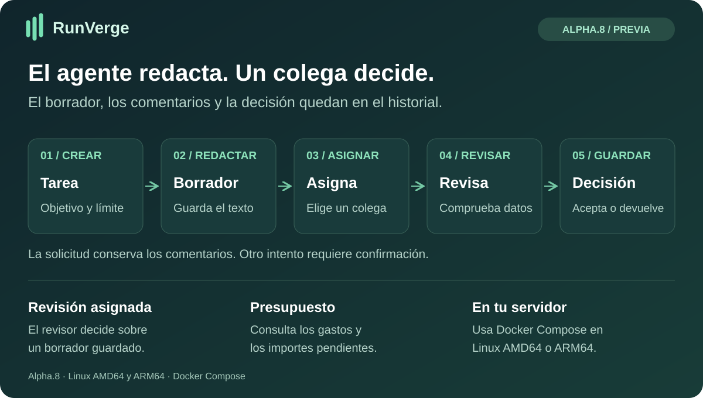
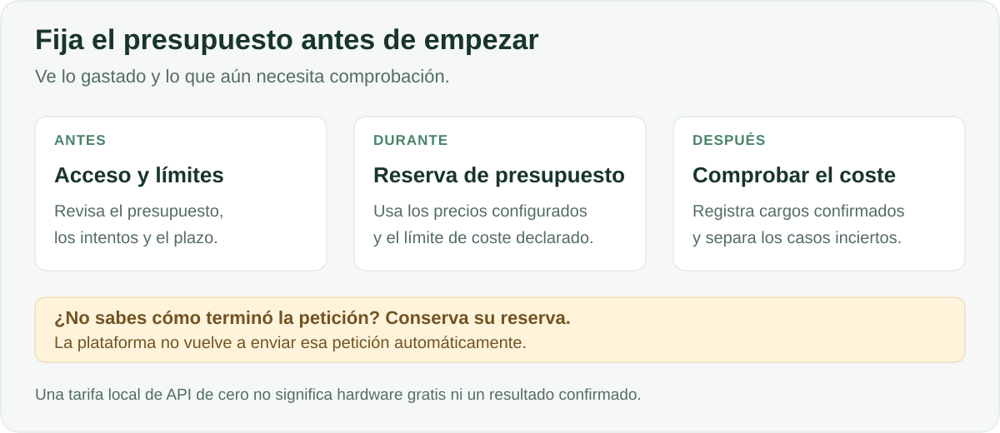
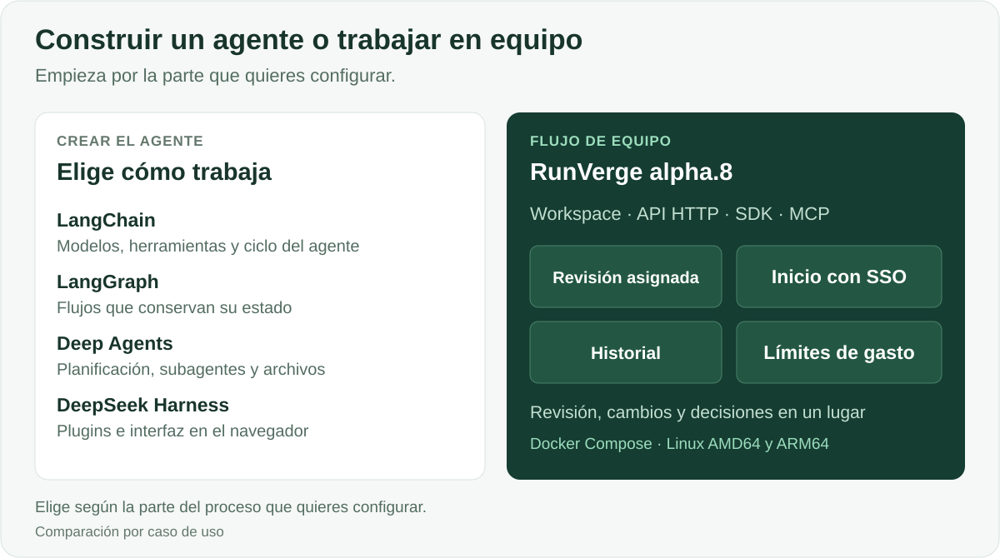

# RunVerge

**Un espacio de trabajo autogestionado para equipos que encargan tareas a agentes y revisan los resultados.**

[**Alpha.8 · Descargas y notas de la versión**](https://github.com/ArtAndrew/RunVerge/releases/tag/0.14.0-alpha.8) · [English](README.md) · [Русский](README.ru.md) · [Español](README.es.md) · [Português (Brasil)](README.pt-BR.md) · [Deutsch](README.de.md) · [Français](README.fr.md) · [简体中文](README.zh-CN.md)



Entrega al agente una tarea y sus materiales. Cuando guarde un borrador, asígnaselo a un compañero. Lo encontrará en **Asignadas a mí** y podrá aceptarlo o pedir cambios. El borrador y la decisión quedan en el historial.

## Instalación en Linux

Descarga AMD64 para servidores Intel o AMD, o ARM64 para un servidor Arm. Descomprime el paquete y carga la imagen de Docker.

```sh
docker image load -i image.tar.gz
docker compose -f deploy/pilot.compose.yaml up --no-build --wait --wait-timeout 900
```

- **[Piloto de equipo](docs/COMPOSE-PILOT.md)**. Docker Compose inicia un modelo local en CPU y crea una cuenta propietaria y dos miembros. Prueba la tarea incluida con datos de ejemplo.
- **[Inicio de sesión de la organización](docs/ORGANIZATION-COMPOSE.md)**. Usa HTTPS y tu proveedor OpenID Connect. Vincula cada cuenta corporativa a un miembro de RunVerge y asigna su rol.

El piloto local descarga unos 1,12 GB de pesos en el primer inicio. El perfil HTTPS utiliza un modelo que configuras por separado.

## A quién le sirve

A equipos de operaciones que preparan avisos o procedimientos, equipos de ingeniería que revisan trabajo generado con IA y desarrolladores que buscan un espacio interno con API. Empieza con una tarea recurrente que alguien de tu equipo ya revise.

## Qué controla RunVerge

- El revisor asignado decide sobre un borrador guardado. Cada nuevo borrador tiene su propia asignación.
- Una solicitud de cambios conserva los comentarios. Otra ejecución del modelo requiere una confirmación aparte.
- La tarea muestra el límite, los gastos confirmados y los importes pendientes de conciliar. El revisor compara el texto con los materiales de origen.



## Cómo encaja con otras herramientas

LangChain, LangGraph, Deep Agents y DeepSeek Harness ofrecen formas de construir o personalizar agentes. RunVerge aporta al equipo la interfaz de trabajo, la revisión asignada, el historial y un perfil de instalación en Linux.



## Interfaces para desarrollo

[API HTTP](contracts/openapi.json) · [SDK de Python](packages/python-sdk) · [SDK de TypeScript](packages/typescript-sdk) · [Adaptador MCP](docs/MCP-ADAPTER.md)

Alpha.8 es una versión preliminar para instalaciones nuevas y datos de prueba. El flujo SSO se probó con un proveedor aislado. El paquete anterior para macOS ARM64 está en [alpha.7](https://github.com/ArtAndrew/RunVerge/releases/tag/0.14.0-alpha.7).

## Licencia

El servidor y la interfaz web usan ELv2. Los SDK de cliente y los ejemplos usan Apache 2.0.
