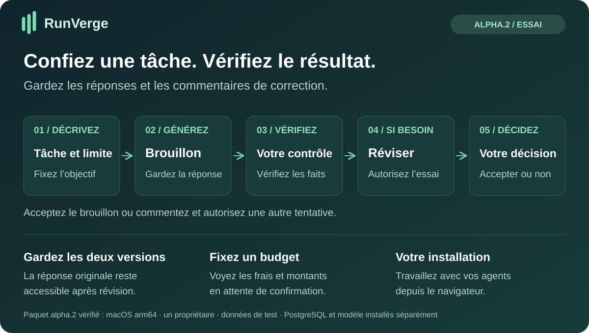
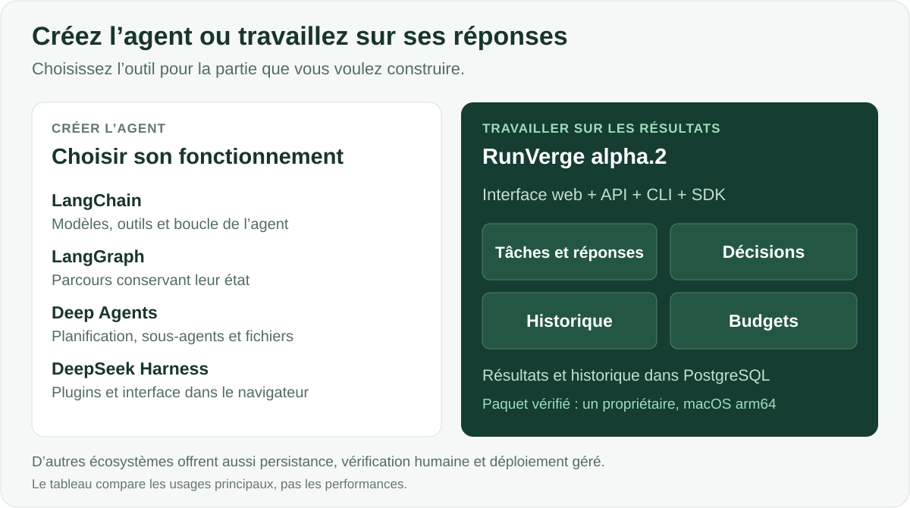

# RunVerge

**Confiez des tâches aux agents, vérifiez les réponses et gardez les révisions.**

[English](README.md) · [Русский](README.ru.md) · [Español](README.es.md) · [Português (Brasil)](README.pt-BR.md) · [Deutsch](README.de.md) · [Français](README.fr.md) · [简体中文](README.zh-CN.md)

RunVerge est une application pour travailler avec des agents d’IA. Décrivez la tâche et son budget, recevez un brouillon, commentez-le et décidez de l’accepter ou d’autoriser une autre tentative. La réponse originale reste accessible après les corrections.

[**Commencer →**](docs/QUICKSTART-ALPHA.md) · [**Télécharger alpha.3 →**](https://github.com/ArtAndrew/RunVerge/releases/tag/0.14.0-alpha.3) · [**Première tâche →**](examples/alpha-first-task.md) · [**Donner un avis →**](https://github.com/ArtAndrew/RunVerge/issues/new/choose)

> **Alpha.3 expérimentale :** macOS arm64, un propriétaire local et uniquement des données de test. PostgreSQL 18 se configure séparément. Utilisez un modèle local ou OpenRouter. Cette version ne prend pas en charge la restauration complète, la mise à niveau des installations existantes ni un déploiement de production à l’échelle d’une organisation. [Périmètre pris en charge](docs/SUPPORT.md).

## Où fonctionne RunVerge et quel modèle utilise-t-il ?

RunVerge et le modèle sont des services séparés. RunVerge conserve tâches et résultats ; le modèle reçoit une requête et génère une réponse. Le moteur comprend une connexion HTTPS Chat Completions configurable par l’administrateur.

Le paquet alpha.3 fonctionne sur macOS arm64 et comprend la configuration des modèles locaux ainsi qu’un [profil texte pour OpenRouter](docs/OPENROUTER.md). Choisissez un modèle, conservez sa clé dans un fichier privé et vérifiez le brouillon. Le modèle OpenRouter s’exécute chez le fournisseur. Les connexions directes à DeepSeek, Nebius Token Factory et Z.ai et les paquets natifs Windows/Linux restent hors de cette version. La vérification d’un modèle ne prouve pas la compatibilité avec tous les fournisseurs.

[Essayer OpenRouter](https://openrouter.ai/) · [Le connecter à RunVerge](docs/OPENROUTER.md).

La branche `main` propose un [aperçu pour serveur Linux à compiler depuis les sources](docs/LINUX-SERVER.md), pour une nouvelle installation avec des données de test. L’installation, le worker séparé et la conservation des résultats après redémarrage ont été vérifiés sur Linux amd64. Cet aperçu est distinct du téléchargement alpha.3. Le guide est pour l’instant en anglais.

L’hôte de l’application et le fournisseur du modèle se choisissent séparément. Le paquet Mac actuel ne signifie pas que le produit doit utiliser uniquement des modèles locaux.

## À qui s’adresse le produit ?

| Profil | Besoin | Ce que vous pouvez essayer |
|---|---|---|
| Développeur d’une application d’IA | Un parcours de vérification autour du travail de l’agent | Créer agents et tâches, examiner brouillons et tentatives via l’interface, l’API ou les SDK |
| Responsable technique | Comprendre ce qui a été produit et décidé | Suivre les matériaux originaux, commentaires, décisions et état des coûts |
| Premier utilisateur accompagné d’un développeur | Préparer de courts documents à partir de faits fournis | Résumer un texte, rédiger une consigne ou comparer des options, puis vérifier le résultat |

L’installation alpha prend en charge **un propriétaire**. Ces profils n’impliquent pas un service partagé entre plusieurs utilisateurs.

## Avantages pratiques

- **Un parcours assemblé :** tâche, brouillon, commentaires et acceptation ou rejet dans une application.
- **Un historique conservé :** les tentatives gardent leurs propres matériaux ; une correction ne remplace pas l’original.
- **Des révisions maîtrisées :** demander des modifications met la tâche en pause. Une nouvelle tentative exige un consentement distinct concernant les coûts.
- **Une comptabilité explicite :** réservations, dépenses confirmées et résultats incertains sont distingués.
- **Un modèle local :** essayez sans API de modèle payante ; le matériel et l’énergie conservent un coût.
- **Des intégrations :** l’API, la CLI et les SDK Python et TypeScript suivent les mêmes contrats publics.

Utilisez RunVerge si vous cherchez des pages de tâches avec brouillons conservés, décisions de vérification et suivi des coûts. Un harness général est un autre point de départ : il donne davantage de contrôle sur le comportement de l’agent lui-même.

## Comparaison avec d’autres outils

| Projet | Orientation principale | Quand le choisir |
|---|---|---|
| [LangChain](https://docs.langchain.com/oss/python/langchain/overview) | Modèles, outils, middleware et boucles d’agents | Vous voulez composer le comportement de l’agent dans votre application |
| [LangGraph](https://docs.langchain.com/oss/python/langgraph/overview) | Orchestration avec état, exécution durable et intervention humaine | Vous avez besoin de graphes personnalisés avec étapes programmées et étapes pilotées par un modèle |
| [Deep Agents](https://docs.langchain.com/oss/python/deepagents/overview) | Planification, sous-agents, contexte de fichiers et mémoire | Vous avez besoin de ces capacités comme briques de l’agent |
| [DeepSeek Harness](https://github.com/deepseek-ai/deepseek-harness) | Harness extensible par plugins avec interface web | Vous voulez personnaliser le harness au moyen de plugins |
| **RunVerge alpha.3** | **Application locale de tâches et de vérification** | **Vous voulez évaluer le parcours avec un propriétaire et des données de test** |

Les présentations officielles liées ont été vérifiées le 28 octobre 2026. La comparaison porte sur les points de départ, pas sur des fonctions prétendument absentes ailleurs. LangGraph et Deep Agents proposent aussi persistance et intervention humaine ; l’écosystème LangChain offre des produits de déploiement géré. Aucune preuve comparative ne démontre une supériorité de RunVerge en qualité, vitesse, sécurité ou coût total.

## Contrôle de l’exécution et des coûts

Le budget, le nombre de tentatives et le délai limitent l’admission de nouveau travail. Ils ne garantissent ni l’exactitude du texte ni la facture finale du fournisseur. Une opération envoyée dont l’issue est incertaine conserve sa réservation et n’est pas répétée à l’aveugle. Un tarif local d’API à zéro ne mesure ni CPU/GPU, ni électricité, ni amortissement, et ne rend pas gratuits les outils payants.

**MCP :** un [exemple limité de lecture de texte](docs/MCP-READ.md) utilise une configuration de confiance, des permissions et une approbation d’exécution. Les serveurs arbitraires, OAuth et un catalogue général de connecteurs ne font pas partie d’alpha.3.

## Essayer le parcours

1. Suivez le [démarrage rapide](docs/QUICKSTART-ALPHA.md) pour installer et configurer PostgreSQL et le modèle.
2. Exécutez la [première tâche](examples/alpha-first-task.md) avec cinq faits d’exemple.
3. Vérifiez le brouillon, consignez une correction et autorisez séparément une autre tentative.
4. Examinez les deux matériaux et décidez quoi accepter. Reviendriez-vous avec une deuxième tâche ?

**L’interface d’alpha.3 n’est disponible qu’en anglais et en russe.** Les sept langues du README ne sont pas sept traductions de l’interface. Changer la langue de l’interface préserve la connexion et le travail en cours ; cela ne traduit ni tâches ni réponses. [Comportement linguistique](docs/LANGUAGES.md).

## Limites actuelles et documentation

Un agent a vérifié le parcours de publication ; les essais indépendants par de nouveaux utilisateurs restent à mener. Un petit modèle local peut omettre des faits ou tronquer sa réponse. Conservez les résultats importants hors de la plateforme.

Restauration complète, mises à niveau, usage en équipe, cycle complet du SSO d’entreprise, exploitation par un fournisseur cloud, intégrations MCP arbitraires et performances de production ne sont pas validés pour alpha.3. N’exposez pas l’installation comme service public multiutilisateur. Il n’existe pas de comparaison côte à côte ; distinguez les artefacts par identifiant et date de création.

Paquets et SHA-256 se trouvent dans [Releases](https://github.com/ArtAndrew/RunVerge/releases). Il n’y a pas de signature de l’éditeur ; la somme de contrôle vérifie la correspondance avec la valeur publiée, pas l’identité de l’éditeur.

- [Installation](docs/NATIVE-BUNDLE.md) · [modèles](docs/LOCAL-MODELS.md) · [MCP](docs/MCP-READ.md)
- [Notes de version](docs/RELEASE-NOTES-alpha.3.md) · [support](docs/SUPPORT.md) · [validation](docs/VALIDATION-alpha.1.md)
- [Développement](docs/DEVELOPMENT.md) · [API](contracts/README.md) · [contenu public](docs/PUBLIC-SOURCE.md)

[Envoyez un avis](https://github.com/ArtAndrew/RunVerge/issues/new/choose) avec système, version et étape difficile. Ne joignez ni jetons, ni configuration privée, ni chaînes de connexion, ni documents privés. Les guides détaillés liés peuvent être en anglais ou en russe.

## Technologies et licences

Serveur et workers Go, PostgreSQL, Workspace React/TypeScript et SDK Python et TypeScript. La commande CLI reste `platform` ; les modules internes conservent `agent-platform`.

Serveur, CLI, application web, documentation et schémas : [Elastic License 2.0](LICENSE). SDK et exemples : Apache-2.0 selon les licences incluses. Les dépendances gardent leurs licences. ELv2 donne accès au code source, mais n’est pas une licence open source reconnue par l’OSI. [Périmètres des licences](docs/LICENSING.md).
