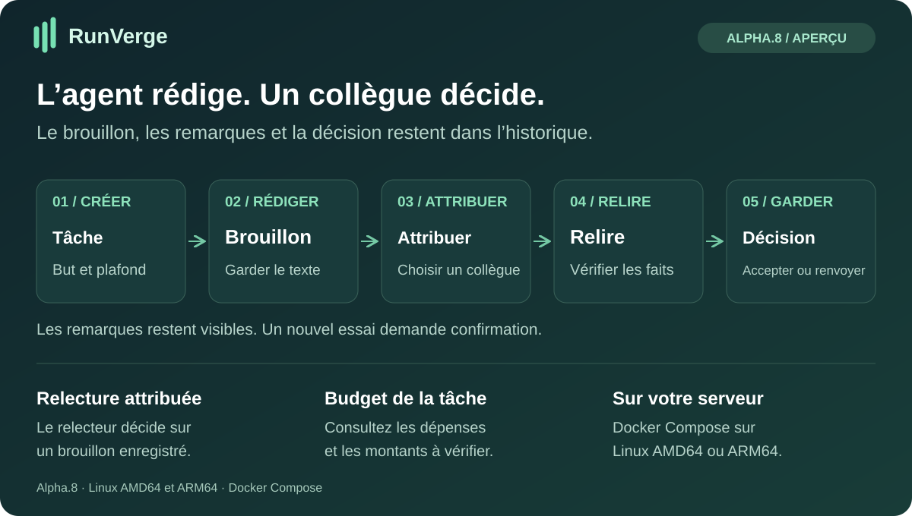
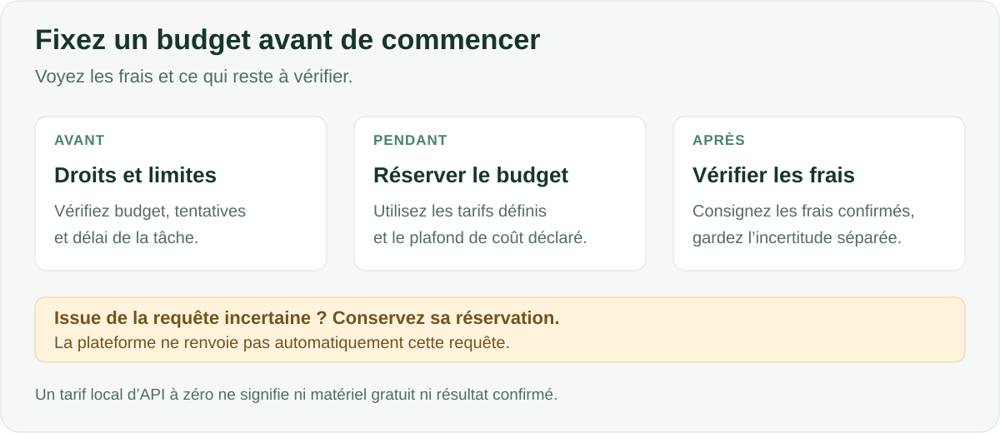
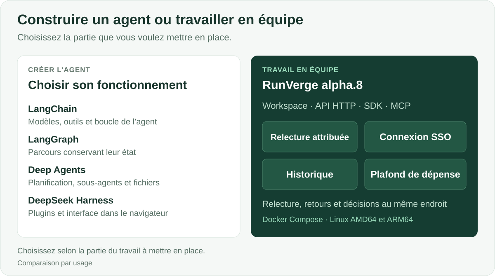

# RunVerge

**Un espace de travail auto-hébergé pour confier des tâches à des agents et faire vérifier leurs résultats en équipe.**

[**Alpha.8 · Téléchargements et notes de version**](https://github.com/ArtAndrew/RunVerge/releases/tag/0.14.0-alpha.8) · [English](README.md) · [Русский](README.ru.md) · [Español](README.es.md) · [Português (Brasil)](README.pt-BR.md) · [Deutsch](README.de.md) · [Français](README.fr.md) · [简体中文](README.zh-CN.md)



Donnez à l’agent une tâche et ses sources. Confiez ensuite le brouillon enregistré à un collègue. Il le retrouve dans **Mes relectures**, puis l’accepte ou demande des corrections. Le brouillon et la décision restent dans l’historique.

## Installation sous Linux

Téléchargez AMD64 pour un serveur Intel ou AMD, ou ARM64 pour un serveur Arm. Décompressez le paquet et chargez l’image Docker.

```sh
docker image load -i image.tar.gz
docker compose -f deploy/pilot.compose.yaml up --no-build --wait --wait-timeout 900
```

- **[Pilote en équipe](docs/COMPOSE-PILOT.md)**. Docker Compose lance un modèle local sur CPU et crée un compte propriétaire et deux membres. Essayez la tâche fournie avec des données fictives.
- **[Connexion de l’organisation](docs/ORGANIZATION-COMPOSE.md)**. Utilisez HTTPS et votre fournisseur OpenID Connect. Reliez chaque compte professionnel à un membre RunVerge et définissez son rôle.

Le pilote local télécharge environ 1,12 Go de poids du modèle au premier démarrage. Le profil HTTPS utilise un modèle configuré séparément.

## À qui s’adresse RunVerge ?

Aux équipes qui rédigent des annonces ou des procédures, aux équipes techniques qui relisent des résultats d’IA et aux développeurs qui veulent un espace interne avec une API. Commencez par une tâche récurrente que votre équipe vérifie déjà.

## Ce que RunVerge conserve

- Le relecteur désigné décide sur un brouillon enregistré. Chaque nouveau brouillon a sa propre attribution.
- La demande de correction conserve les remarques. Un nouvel essai du modèle demande une confirmation distincte.
- Le plafond, les dépenses confirmées et les montants à rapprocher sont visibles séparément. Le relecteur compare le texte à ses sources.



## Comment RunVerge s’intègre à vos outils

LangChain, LangGraph, Deep Agents et DeepSeek Harness donnent des moyens de construire ou de personnaliser des agents. RunVerge fournit l’espace de travail, la relecture attribuée, l’historique et l’installation Linux pour l’équipe.



## Interfaces de développement

[API HTTP](contracts/openapi.json) · [SDK Python](packages/python-sdk) · [SDK TypeScript](packages/typescript-sdk) · [Adaptateur MCP](docs/MCP-ADAPTER.md)

Alpha.8 est une version préliminaire pour les nouvelles installations et les données de test. Le parcours SSO a été vérifié avec un fournisseur de test isolé. Le précédent paquet macOS ARM64 est disponible dans [alpha.7](https://github.com/ArtAndrew/RunVerge/releases/tag/0.14.0-alpha.7).

## Licence

Le serveur et l’interface web utilisent ELv2. Les SDK clients et les exemples utilisent Apache 2.0.
