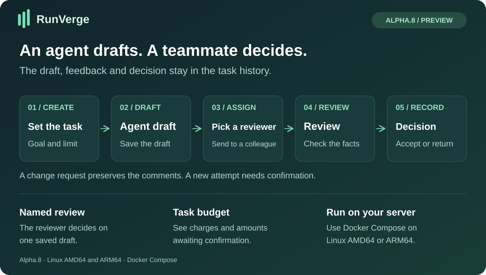
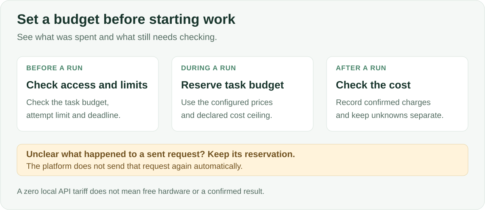
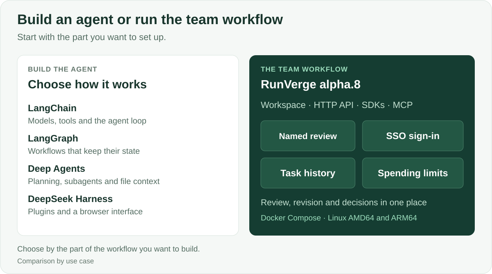

# RunVerge

**A self-hosted workspace for teams that give agents tasks and review what comes back.**

[**Alpha.8 · Downloads and release notes**](https://github.com/ArtAndrew/RunVerge/releases/tag/0.14.0-alpha.8) · [English](README.md) · [Русский](README.ru.md) · [Español](README.es.md) · [Português (Brasil)](README.pt-BR.md) · [Deutsch](README.de.md) · [Français](README.fr.md) · [简体中文](README.zh-CN.md)



Give an agent source material and a task. Send its saved draft to a colleague. They open it in **Assigned to me**, then accept it or ask for changes. Both the draft and the decision stay in the task history.

## Run it on Linux

Download the AMD64 package for Intel or AMD servers, or ARM64 for an Arm server. Unpack it and load the Docker image.

```sh
docker image load -i image.tar.gz
docker compose -f deploy/pilot.compose.yaml up --no-build --wait --wait-timeout 900
```

- **[Team pilot](docs/COMPOSE-PILOT.md)**. Start Docker Compose with a local CPU model, an owner and two member accounts. Try the supplied draft and review task with test data.
- **[Organization sign-in](docs/ORGANIZATION-COMPOSE.md)**. Use HTTPS and your OpenID Connect provider. Link each corporate account to a RunVerge member and set its role.

The local pilot downloads about 1.12 GB of model weights on first startup. The HTTPS profile uses a model you configure separately.

## Who it is for

Operations teams drafting announcements or procedures, engineering teams reviewing AI-generated work, and developers who want a usable internal workspace with an API. Start with one recurring task that somebody on your team already checks.

## What RunVerge handles

- A named reviewer decides on one saved draft. A new draft has its own assignment.
- A request for changes saves the feedback. Starting another model attempt requires a separate confirmation.
- Task budgets, recorded costs and unresolved charges are visible separately. The reviewer checks the draft against the source material.



## How it fits alongside other tools

LangChain, LangGraph, Deep Agents and DeepSeek Harness give you ways to build or customize agents. RunVerge starts at the team workflow. It ships the Workspace, task history, named review and a Linux deployment profile.



## Developer interfaces

[HTTP API](contracts/openapi.json) · [Python SDK](packages/python-sdk) · [TypeScript SDK](packages/typescript-sdk) · [MCP adapter](docs/MCP-ADAPTER.md)

Alpha.8 is a preview for fresh installations and test data. The SSO workflow was exercised with an isolated test issuer. For the earlier macOS ARM64 download, see [alpha.7](https://github.com/ArtAndrew/RunVerge/releases/tag/0.14.0-alpha.7).

## License

The server and Workspace use ELv2. The client SDKs and examples use Apache 2.0.
