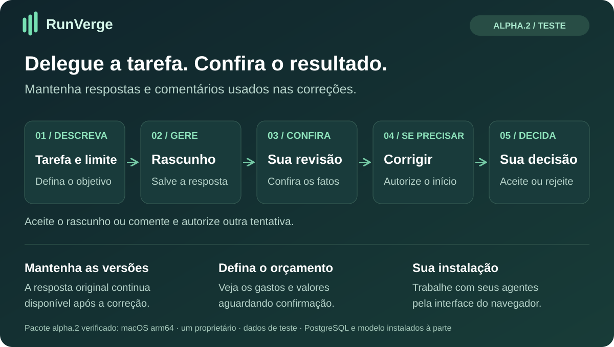
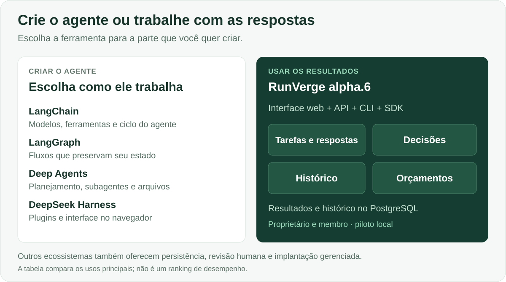
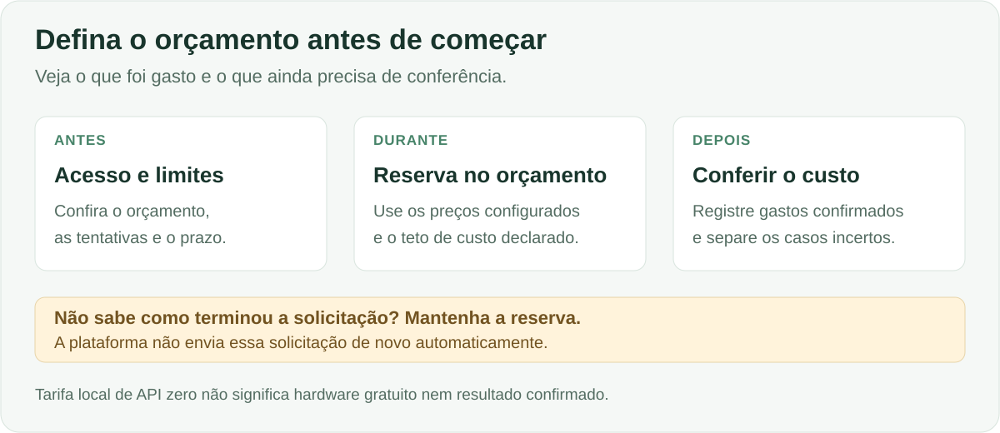

# RunVerge

**Delegue tarefas a agentes, confira as respostas e mantenha o histórico de revisões.**

[English](README.md) · [Русский](README.ru.md) · [Español](README.es.md) · [Português (Brasil)](README.pt-BR.md) · [Deutsch](README.de.md) · [Français](README.fr.md) · [简体中文](README.zh-CN.md)

RunVerge é uma aplicação para trabalhar com agentes de IA. Descreva a tarefa e seu orçamento, receba um rascunho, deixe comentários e decida se aceita a resposta ou autoriza outra tentativa. A resposta original continua disponível após as correções.

[**Começar →**](docs/QUICKSTART-ALPHA.md) · [**Baixar alpha.2 →**](https://github.com/ArtAndrew/RunVerge/releases/tag/0.14.0-alpha.2) · [**Primeira tarefa →**](examples/alpha-first-task.md) · [**Feedback →**](https://github.com/ArtAndrew/RunVerge/issues/new/choose)

> **Alpha.1 experimental:** macOS arm64, um proprietário local e apenas dados de teste. PostgreSQL 18 e o servidor local do modelo, como Ollama, são configurados separadamente. Restauração completa, atualização de instalações existentes e implantação em produção para uma organização inteira não são suportadas nesta versão. [Escopo suportado](docs/SUPPORT.md).

## Onde o RunVerge funciona e qual modelo utiliza

RunVerge e o modelo são serviços separados. RunVerge guarda tarefas e resultados; o modelo recebe uma solicitação e gera a resposta. O motor inclui uma conexão HTTPS Chat Completions configurável pelo administrador.

O pacote alpha.2 publicado e o guia foram verificados no macOS arm64 com um modelo local. Não incluem pacotes para Windows/Linux nem configurações prontas e verificadas para OpenRouter, DeepSeek, Nebius Token Factory e Z.ai. Uma conexão API configurável não comprova, sozinha, a compatibilidade com todos os provedores.

O computador da aplicação e o provedor do modelo são escolhas separadas. O pacote atual para Mac não significa que o produto deva usar apenas modelos locais.

## Para quem é?

| Perfil | Necessidade | O que pode testar hoje |
|---|---|---|
| Desenvolvedor de aplicações com IA | Um fluxo de revisão em torno do agente | Criar agentes e tarefas, consultar rascunhos e tentativas pela interface, API ou SDK |
| Líder técnico | Entender o que foi produzido e decidido | Acompanhar materiais originais, comentários, decisões e situação dos custos |
| Primeiro usuário com apoio de um desenvolvedor | Elaborar documentos curtos com fatos fornecidos | Resumir textos, redigir instruções ou comparar opções e revisar o resultado |

A instalação alpha atende **um proprietário**; os perfis acima não significam um serviço compartilhado por vários usuários.

## Vantagens práticas

- **Fluxo integrado:** tarefa, rascunho, comentários e aceitação ou rejeição em uma aplicação.
- **Histórico preservado:** tentativas separadas mantêm seus materiais; a correção não substitui o original.
- **Revisões sob controle:** pedir alterações pausa a tarefa. Uma nova tentativa exige consentimento separado sobre custos.
- **Custos explícitos:** reservas, gastos confirmados e resultados incertos são registrados separadamente.
- **Modelo local:** experimente sem uma API paga de modelo; equipamento e energia continuam tendo custo.
- **Integração:** API, CLI e SDKs de Python e TypeScript usam contratos públicos comuns.

Use RunVerge se precisar de páginas de tarefas com rascunhos salvos, decisões de revisão e registros de custos. Um harness geral é outro ponto de partida: oferece mais controle sobre o comportamento do próprio agente.

## Comparação com outras ferramentas

| Projeto | Foco principal | Quando escolher |
|---|---|---|
| [LangChain](https://docs.langchain.com/oss/python/langchain/overview) | Modelos, ferramentas, middleware e ciclos de agentes | Você quer compor o agente na sua aplicação |
| [LangGraph](https://docs.langchain.com/oss/python/langgraph/overview) | Orquestração com estado, execução durável e intervenção humana | Você precisa de grafos personalizados com etapas programadas e etapas do modelo |
| [Deep Agents](https://docs.langchain.com/oss/python/deepagents/overview) | Planejamento, subagentes, contexto de arquivos e memória | Você precisa desses recursos como base do agente |
| [DeepSeek Harness](https://github.com/deepseek-ai/deepseek-harness) | Harness extensível por plugins com interface web | Você quer personalizar o harness por plugins |
| **RunVerge alpha.2** | **Aplicação local de tarefas e revisão** | **Você quer avaliar o fluxo com um proprietário e dados de teste** |

As descrições oficiais vinculadas foram conferidas em 28 de outubro de 2026. A comparação trata de pontos de partida, não de recursos ausentes nos demais projetos. LangGraph e Deep Agents também oferecem persistência e intervenção humana; o ecossistema LangChain possui produtos de implantação gerenciada. Não há evidências comparativas de superioridade do RunVerge em qualidade, velocidade, segurança ou custo total.

## Controle de execução e custos

Orçamento, número de tentativas e prazo restringem a admissão de novo trabalho. Não garantem a precisão do texto nem a fatura final do provedor. Uma operação enviada com resultado incerto mantém sua reserva e não é repetida às cegas. Tarifa local de API zero não mede CPU/GPU, energia ou depreciação, nem torna ferramentas pagas gratuitas.

**MCP:** há um [exemplo limitado de leitura de texto](docs/MCP-READ.md) com configuração confiável, permissões e aprovação da execução. Servidores arbitrários, OAuth e um catálogo geral de conectores não fazem parte da alpha.2.

## Como experimentar

1. Siga o [início rápido](docs/QUICKSTART-ALPHA.md) para instalar e configurar PostgreSQL e o modelo.
2. Execute a [primeira tarefa](examples/alpha-first-task.md) com cinco fatos de exemplo.
3. Confira o rascunho, registre uma correção e autorize outra tentativa separadamente.
4. Examine os dois materiais e decida o que aceitar. Conte se voltaria com uma segunda tarefa.

**A interface da alpha.2 está apenas em inglês e russo.** Os sete idiomas do README não são sete traduções da interface. A mudança de idioma da interface mantém a conexão e o trabalho atual; não traduz tarefas nem respostas. [Idiomas](docs/LANGUAGES.md).

## Limites atuais e documentação

Um agente verificou o fluxo de publicação; ainda falta avaliação independente por novos usuários. Um modelo local pequeno pode omitir fatos ou truncar a resposta. Guarde resultados importantes fora da plataforma.

Restauração completa, atualizações, uso em equipe, ciclo empresarial de SSO, implantação para provedores de nuvem, MCP arbitrário e desempenho de produção não foram aceitos para a alpha.2. Não exponha a instalação como serviço público multiusuário. Não há comparação lado a lado; identifique os materiais por ID e data.

Os pacotes e valores SHA-256 estão em [Releases](https://github.com/ArtAndrew/RunVerge/releases). Não há assinatura do editor; o checksum verifica correspondência com o valor publicado, não a identidade do editor.

- [Instalação](docs/NATIVE-BUNDLE.md) · [modelos](docs/LOCAL-MODELS.md) · [MCP](docs/MCP-READ.md)
- [Notas](docs/RELEASE-NOTES-alpha.2.md) · [suporte](docs/SUPPORT.md) · [validação](docs/VALIDATION-alpha.1.md)
- [Desenvolvimento](docs/DEVELOPMENT.md) · [API](contracts/README.md) · [conteúdo público](docs/PUBLIC-SOURCE.md)

[Envie feedback](https://github.com/ArtAndrew/RunVerge/issues/new/choose) com sistema operacional, versão e etapa difícil. Não anexe tokens, configurações privadas, strings de conexão ou documentos privados. Os guias detalhados vinculados podem estar em inglês ou russo.

## Tecnologia e licenças

Servidor e workers em Go, PostgreSQL, Workspace React/TypeScript e SDKs de Python e TypeScript. O comando CLI continua `platform`; módulos internos mantêm `agent-platform`.

Servidor, CLI, aplicação web, documentação e diagramas: [Elastic License 2.0](LICENSE). SDKs e exemplos: Apache-2.0 conforme as licenças incluídas. As dependências mantêm suas licenças. ELv2 disponibiliza o código-fonte, mas não é uma licença de código aberto reconhecida pela OSI. [Limites das licenças](docs/LICENSING.md).
