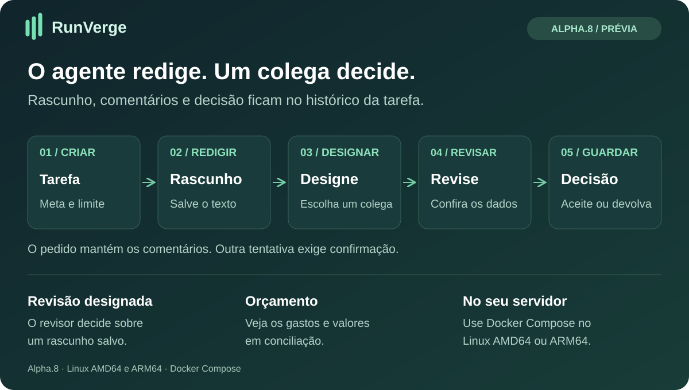
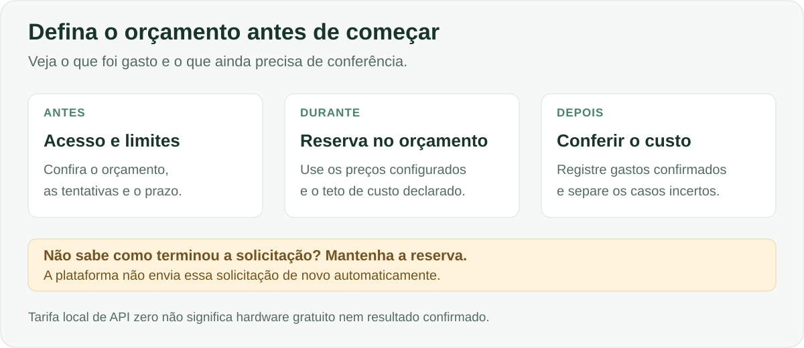
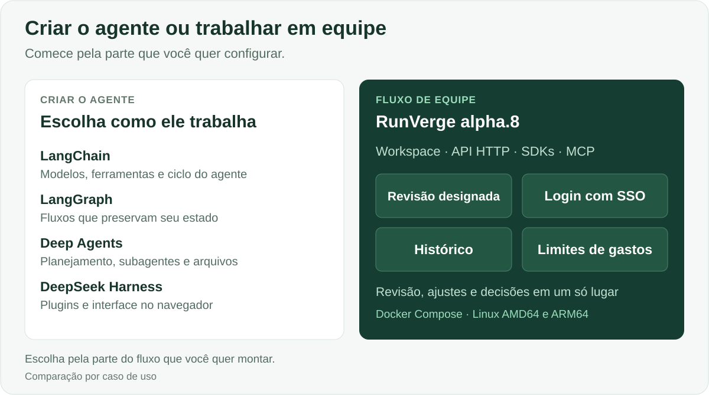

# RunVerge

**Um espaço de trabalho no seu servidor para equipes que delegam tarefas a agentes e revisam os resultados.**

[**Alpha.8 · Downloads e notas da versão**](https://github.com/ArtAndrew/RunVerge/releases/tag/0.14.0-alpha.8) · [English](README.md) · [Русский](README.ru.md) · [Español](README.es.md) · [Português (Brasil)](README.pt-BR.md) · [Deutsch](README.de.md) · [Français](README.fr.md) · [简体中文](README.zh-CN.md)



Passe a tarefa e os materiais ao agente. Assim que ele salvar um rascunho, designe um colega para revisar. A pessoa encontra o rascunho em **Atribuídas a mim** e pode aceitar ou pedir ajustes. O rascunho e a decisão ficam no histórico.

## Instalação no Linux

Baixe AMD64 para servidores Intel ou AMD, ou ARM64 para um servidor Arm. Extraia o pacote e carregue a imagem Docker.

```sh
docker image load -i image.tar.gz
docker compose -f deploy/pilot.compose.yaml up --no-build --wait --wait-timeout 900
```

- **[Piloto de equipe](docs/COMPOSE-PILOT.md)**. O Docker Compose inicia um modelo local em CPU e cria uma conta proprietária e dois membros. Use a tarefa incluída com dados de exemplo.
- **[Login da organização](docs/ORGANIZATION-COMPOSE.md)**. Use HTTPS e seu provedor OpenID Connect. Vincule cada conta corporativa a um membro do RunVerge e defina seu papel.

O piloto local baixa cerca de 1,12 GB de pesos no primeiro início. O perfil HTTPS usa um modelo configurado à parte.

## Para quem é o RunVerge

Para equipes de operações que preparam avisos ou procedimentos, equipes de engenharia que revisam trabalhos de IA e desenvolvedores que buscam um ambiente interno com API. Comece por uma tarefa recorrente que alguém da equipe já revise.

## O que fica sob controle

- O colega designado decide sobre um rascunho salvo. Cada novo rascunho tem sua própria designação.
- Um pedido de ajustes guarda os comentários. Uma nova tentativa do modelo exige outra confirmação.
- A tarefa mostra o limite, o gasto confirmado e os valores em conciliação. Quem revisa compara o texto com os materiais de origem.



## Como se encaixa com outras ferramentas

LangChain, LangGraph, Deep Agents e DeepSeek Harness oferecem formas de criar ou personalizar agentes. O RunVerge entrega um ambiente de equipe com revisão designada, histórico de tarefas e instalação no Linux.



## Interfaces para desenvolvimento

[API HTTP](contracts/openapi.json) · [SDK Python](packages/python-sdk) · [SDK TypeScript](packages/typescript-sdk) · [Adaptador MCP](docs/MCP-ADAPTER.md)

Alpha.8 é uma prévia para instalações novas e dados de teste. O fluxo SSO foi testado com um provedor isolado. O pacote anterior para macOS ARM64 está em [alpha.7](https://github.com/ArtAndrew/RunVerge/releases/tag/0.14.0-alpha.7).

## Licença

O servidor e a interface web usam ELv2. Os SDKs de cliente e os exemplos usam Apache 2.0.
