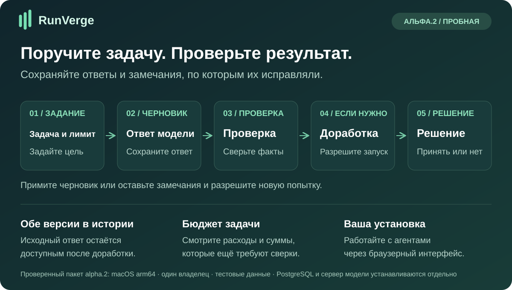
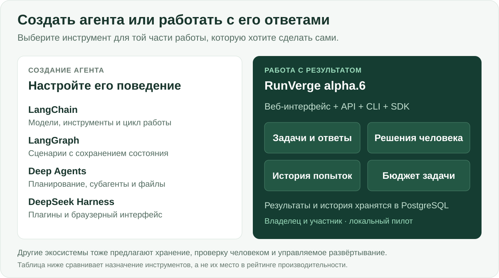

# RunVerge

**Поручайте задачи агентам, проверяйте ответы и сохраняйте историю доработок.**

[English](README.md) · [Русский](README.ru.md) · [Español](README.es.md) · [Português (Brasil)](README.pt-BR.md) · [Deutsch](README.de.md) · [Français](README.fr.md) · [简体中文](README.zh-CN.md)

RunVerge — приложение для работы с AI-агентами. Вы описываете задачу и задаёте бюджет, получаете черновик, оставляете замечания и решаете: принять ответ или запустить доработку. Исходный ответ остаётся доступным после исправлений.

[**Начать →**](docs/QUICKSTART-ALPHA.md) · [**Скачать alpha.4 →**](https://github.com/ArtAndrew/RunVerge/releases/tag/0.14.0-alpha.4) · [**Первая задача →**](examples/alpha-first-task.md) · [**Обратная связь →**](https://github.com/ArtAndrew/RunVerge/issues/new/choose)

> **Экспериментальная alpha.4:** macOS arm64, один локальный владелец, только тестовые данные. PostgreSQL 18 настраивается отдельно. Модель можно запустить локально или подключить через OpenRouter. Полное восстановление, обновление существующих установок и промышленное развёртывание в организации пока не поддерживаются. [Границы поддержки](docs/SUPPORT.md).

## Где работает RunVerge и какую модель он использует

RunVerge и модель — разные сервисы. RunVerge хранит задачи и результаты; модель получает запрос и готовит ответ. В движке есть настраиваемое администратором подключение к API Chat Completions по HTTPS.

Пакет alpha.4 работает на macOS arm64. Можно подключить локальную модель или явно настроить [текстовую модель через OpenRouter](docs/OPENROUTER.md): выбрать модель, сохранить ключ приватно и проверить полученный черновик. Модель OpenRouter выполняется у провайдера, а не на вашем компьютере. Прямые подключения DeepSeek, Nebius Token Factory, Z.ai и нативные пакеты Windows/Linux в этот выпуск не входят. Проверка одной модели не подтверждает совместимость со всеми провайдерами.

[Попробовать OpenRouter](https://openrouter.ai/) · [Подключить к RunVerge](docs/OPENROUTER.md).

В ветке `main` доступен [preview для Linux-сервера со сборкой из исходников](docs/LINUX-SERVER.md): новая установка и только тестовые данные. На Linux amd64 и arm64 проверены установка, отдельный исполнитель и сохранение результата после перезапуска. Это отдельный вариант, он не входит в скачиваемый пакет alpha.4. Инструкция пока на английском.

Компьютер для установки RunVerge и поставщик модели выбираются отдельно. Нынешний пакет для Mac не означает, что продукт должен работать только с локальными моделями.

## Для кого продукт

| Кто вы | Что хотите получить | Что можно попробовать сейчас |
|---|---|---|
| Разработчик приложения с AI | Готовый процесс проверки сгенерированной работы | Создать агента и задачу, работать с ответом и попытками через UI, API или SDK |
| Технический руководитель | Понятную связь между заданием, результатом и решением | Проследить историю материалов, замечания, решения и состояние расходов |
| Первый пользователь с помощью разработчика | Подготовить короткий документ по предоставленным фактам | Получить резюме, инструкцию или сравнение, проверить и доработать |

Установка альфы рассчитана на **одного владельца**. Этот список аудиторий не означает готовность общего многопользовательского сервиса.

## Практические преимущества

| Затруднение | Что включает RunVerge | Польза |
|---|---|---|
| Ответ модели есть, а процесс проверки приходится строить отдельно | Задача, черновик, замечания, принятие и отклонение | Цельный рабочий сценарий в одном приложении |
| При исправлении теряется исходный ответ | Отдельные попытки и сохранённые материалы | Можно проверить обе версии и сохранить оригинал |
| Замечание непреднамеренно запускает новую работу | Замечание приостанавливает задачу; новая попытка требует согласия | Пользователь решает, когда запускать доработку |
| Неясно, чем закончился запрос и сколько он стоил | Резерв, подтверждённый расход и неопределённый исход учитываются отдельно | Видно, что ещё требует сверки |
| Нужна локальная модель | Нативный пакет и настраиваемое подключение | Для первого сценария не нужен платный API модели; оборудование всё равно имеет стоимость |
| Нужна интеграция с другим приложением | API, CLI, Python SDK и TypeScript SDK | Общие операции и контракты для интерфейса и интеграций |

RunVerge подходит, если нужны страницы задач, сохранённые черновики, решения по результатам и учёт расходов. Универсальный агентский harness решает другую часть работы: даёт больше возможностей настроить поведение самого агента.

## Отличия от других инструментов

| Инструмент | Основной акцент | Когда его выбирать | Акцент RunVerge |
|---|---|---|---|
| [LangChain](https://docs.langchain.com/oss/python/langchain/overview) | Модели, инструменты, middleware и цикл агента | Нужно собрать поведение агента внутри своего приложения | Готовый локальный процесс «задача → черновик → проверка → решение» |
| [LangGraph](https://docs.langchain.com/oss/python/langgraph/overview) | Оркестрация с состоянием, устойчивое выполнение, участие человека | Нужны собственные графы с программными и модельными шагами | Готовые модель задач, Workspace и записи решений и расходов |
| [Deep Agents](https://docs.langchain.com/oss/python/deepagents/overview) | Планирование, субагенты, файловый контекст и память | Эти возможности нужны как основа поведения агента | Проверка и доработка сохраняемого результата пользователем |
| [DeepSeek Harness](https://github.com/deepseek-ai/deepseek-harness) | Расширяемый harness с плагинами и Web UI | Нужно настраивать сам harness через плагины | Задачи, решения человека, попытки и бюджет в едином процессе |
| **RunVerge alpha.4** | **Локальное приложение для задач и проверки** | **Нужно попробовать этот сценарий с одним владельцем на тестовых данных** | **UI, постоянная история, отдельное согласие на доработку и учёт** |

Сравнение основано на официальных описаниях по ссылкам, проверенных 28 октября 2026 года. Оно объясняет разные точки входа, а не отсутствие функций у других проектов. LangGraph и Deep Agents также поддерживают сохранение состояния и участие человека; у экосистемы LangChain есть управляемые платформенные продукты. Сравнительных доказательств превосходства RunVerge по качеству ответов, скорости, безопасности или полной стоимости нет.

## Контроль выполнения и расходов

- Замечание и запуск новой попытки — отдельные действия. Новая попытка требует подтверждения расходов.
- Бюджет, предел попыток и срок ограничивают допуск новой работы. Они не гарантируют фактическую точность текста или окончательный счёт провайдера.
- Неопределённый исход сохраняет резерв и не приводит к слепой повторной отправке.
- Нулевой локальный тариф API не измеряет CPU/GPU, электричество или амортизацию и не делает платные инструменты бесплатными.
- **MCP:** есть ограниченный [пример чтения текста](docs/MCP-READ.md) с доверенной конфигурацией, правами и подтверждением выполнения. Произвольные серверы, OAuth и универсальный каталог коннекторов в alpha.4 не входят.

## Как попробовать

1. Пройдите [быстрый старт](docs/QUICKSTART-ALPHA.md): установите пакет и настройте PostgreSQL и модель.
2. Выполните [первую задачу](examples/alpha-first-task.md) с пятью учебными фактами.
3. Проверьте ответ, оставьте замечание и отдельно разрешите новую попытку.
4. Посмотрите оба материала, примите подходящий результат и расскажите, вернулись бы вы со второй задачей.

**Alpha.4 поддерживает семь языков интерфейса:** русский, английский, испанский, бразильский португальский, немецкий, французский и упрощённый китайский.

В alpha.4 подсказка первого запуска ведёт по шагам: **сохранить черновик агента → опубликовать версию → создать задачу и проверить ответ**. Заготовка инструкций для работы с исходным текстом и примеры задач необязательны: они заполняют редактируемые поля только после вашего выбора. Модель не выбирается, агент не публикуется и работа не запускается автоматически.

Язык выбирается в верхней панели и запоминается на этом устройстве. Переключение сохраняет подключение и текущую работу; уже введённые задания, ответы модели и материалы не переводятся. Суммы остаются точными значениями USD без конвертации валют. [Выбор языка, локальные словари и резервный язык](docs/LANGUAGES.md).

## Ограничения и документация

Сценарий выпуска проверял агент; независимая проверка новыми пользователями ещё предстоит. Маленькая локальная модель может пропускать факты и обрезать ответ. Сохраняйте важные результаты вне платформы.

Полное восстановление, обновления, командная работа, полный цикл корпоративного SSO, развёртывание у облачного провайдера, произвольные MCP-интеграции и промышленная производительность не приняты для alpha.4. Не открывайте установку как публичный многопользовательский сервис. Сравнения двух версий рядом пока нет; различайте отдельные артефакты по ID и времени создания.

Пакеты и SHA-256 доступны в [Releases](https://github.com/ArtAndrew/RunVerge/releases). Подписи издателя пока нет: контрольная сумма проверяет соответствие опубликованному значению, а не личность издателя.

- [Установка](docs/NATIVE-BUNDLE.md) · [модели](docs/LOCAL-MODELS.md) · [MCP](docs/MCP-READ.md)
- [Примечания к выпуску](docs/RELEASE-NOTES-alpha.4.md) · [поддержка](docs/SUPPORT.md) · [проверки](docs/VALIDATION-alpha.4.md)
- [Разработка](docs/DEVELOPMENT.md) · [контракты API](contracts/README.md) · [состав исходников](docs/PUBLIC-SOURCE.md)

[Сообщить о проблеме](https://github.com/ArtAndrew/RunVerge/issues/new/choose): укажите ОС, версию и трудный шаг. Не прикладывайте токены, настройки, строки подключения или приватные документы. Подробные инструкции по ссылкам могут быть на английском или русском.

## Технологии и лицензии

Ядро и исполнители — Go, состояние — PostgreSQL, Workspace — React/TypeScript, SDK — Python и TypeScript. Команда CLI остаётся `platform`, внутренние модули — `agent-platform`.

Сервер, CLI, веб-приложение, документация и схемы — [Elastic License 2.0](LICENSE); SDK и примеры — Apache-2.0 по вложенным лицензиям. Зависимости сохраняют свои лицензии. ELv2 предоставляет исходники, но не является OSI-лицензией открытого ПО. [Границы лицензий](docs/LICENSING.md).
