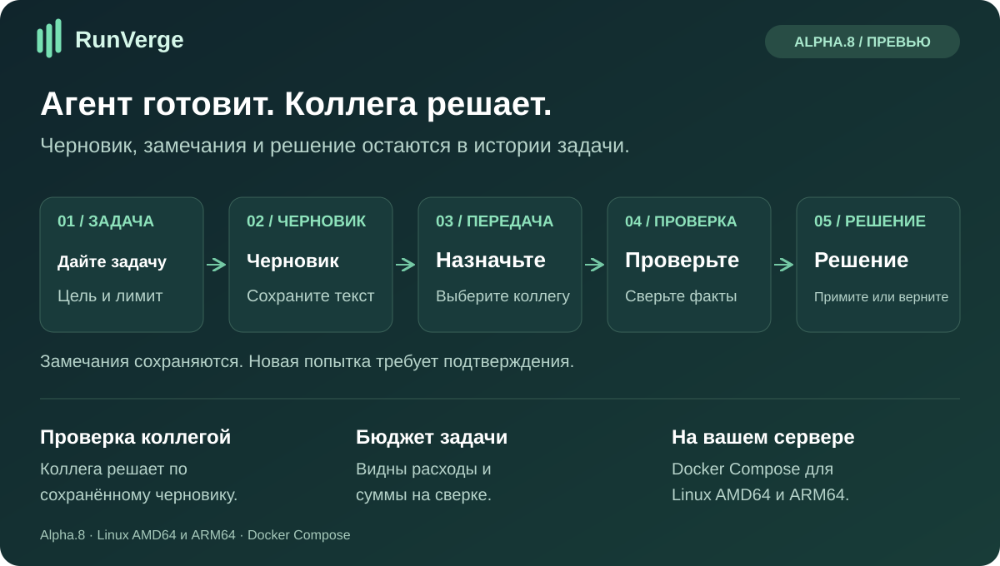
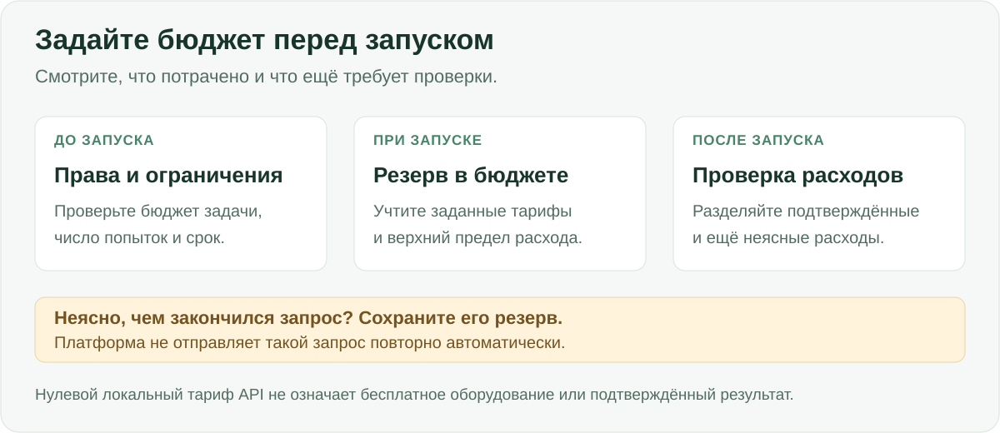
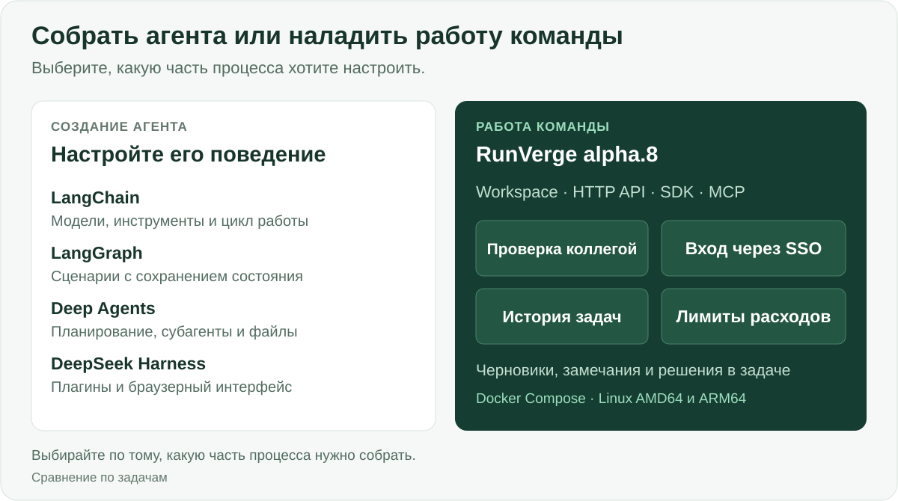

# RunVerge

**Рабочая среда на вашем сервере для задач, которые выполняют агенты и проверяет команда.**

[**Alpha.8 · Скачать и посмотреть изменения**](https://github.com/ArtAndrew/RunVerge/releases/tag/0.14.0-alpha.8) · [English](README.md) · [Русский](README.ru.md) · [Español](README.es.md) · [Português (Brasil)](README.pt-BR.md) · [Deutsch](README.de.md) · [Français](README.fr.md) · [简体中文](README.zh-CN.md)



Передайте агенту задачу и исходные материалы. Когда черновик будет готов, назначьте проверяющего. Коллега найдёт черновик в очереди **«Назначено мне»**, примет его или вернёт на доработку. Черновик и решение останутся в истории задачи.

## Запуск на Linux

Для сервера на Intel или AMD скачайте пакет AMD64. Для сервера на Arm возьмите ARM64. Распакуйте архив и загрузите Docker-образ.

```sh
docker image load -i image.tar.gz
docker compose -f deploy/pilot.compose.yaml up --no-build --wait --wait-timeout 900
```

- **[Командный пилот](docs/COMPOSE-PILOT.md)**. Docker Compose запускает локальную модель на CPU, создаёт владельца и двух участников. Готовый пример покажет, как передать результат на проверку.
- **[Корпоративный вход](docs/ORGANIZATION-COMPOSE.md)**. Разверните Workspace по HTTPS и подключите свой провайдер OpenID Connect. Привяжите корпоративную учётную запись к участнику и задайте ему роль.

При первом запуске пилот скачивает около 1,12 ГБ весов модели. В профиле с HTTPS модель подключается отдельно.

## Для кого RunVerge

Для команд, которые проверяют документы и результаты работы ИИ, и для разработчиков, которым нужна внутренняя рабочая среда с API. Начните с повторяющейся задачи, у которой уже есть ответственный за проверку.

## Что остаётся под контролем

- Назначенный коллега принимает решение по конкретному черновику. Для новой версии можно назначить проверяющего заново.
- Замечания сохраняются отдельно. Чтобы запустить доработку, автор подтверждает новую попытку.
- В задаче видны лимит, подтверждённые расходы и суммы, которые ещё требуют сверки. Проверяющий сверяет текст с исходными материалами.



## Как RunVerge соотносится с другими инструментами

LangChain, LangGraph, Deep Agents и DeepSeek Harness помогают собрать и настроить исполнение агента. RunVerge даёт команде готовый путь от задачи до принятого результата, включая рабочий интерфейс, очередь проверки, историю и установку на Linux.



## Интерфейсы для разработчиков

[HTTP API](contracts/openapi.json) · [Python SDK](packages/python-sdk) · [TypeScript SDK](packages/typescript-sdk) · [MCP-адаптер](docs/MCP-ADAPTER.md)

Alpha.8 — предварительный выпуск для новой установки и тестовых данных. Корпоративный вход проверен с отдельным тестовым провайдером. Предыдущий пакет для macOS ARM64 доступен в [alpha.7](https://github.com/ArtAndrew/RunVerge/releases/tag/0.14.0-alpha.7).

## Лицензия

Сервер и веб-интерфейс распространяются под ELv2. Клиентские SDK и примеры — под Apache 2.0.
