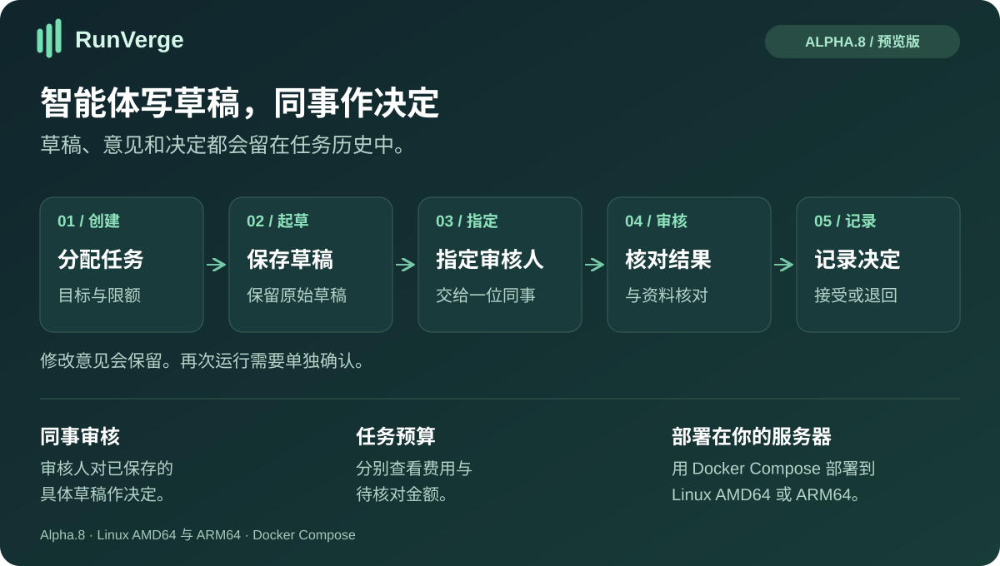
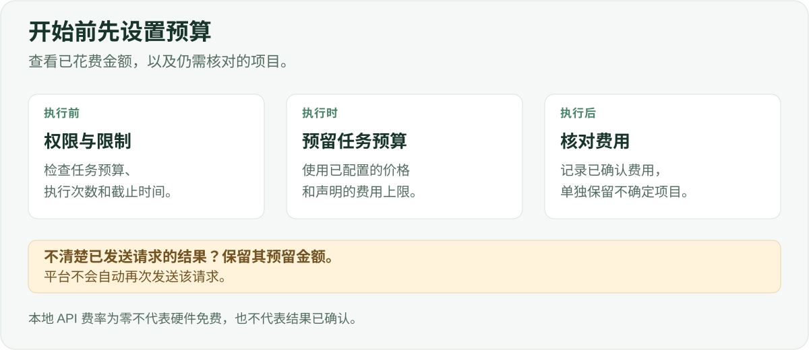
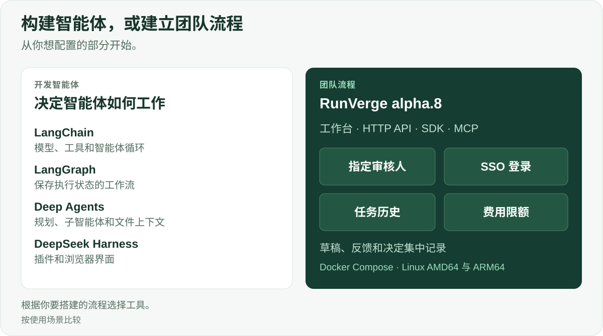

# RunVerge

**一套自托管团队工作台，用来给智能体分配任务、审核结果并保留记录。**

[**Alpha.8 · 下载与版本说明**](https://github.com/ArtAndrew/RunVerge/releases/tag/0.14.0-alpha.8) · [English](README.md) · [Русский](README.ru.md) · [Español](README.es.md) · [Português (Brasil)](README.pt-BR.md) · [Deutsch](README.de.md) · [Français](README.fr.md) · [简体中文](README.zh-CN.md)



把任务和参考资料交给智能体。草稿保存后，指定一位同事审核。同事可以在**分配给我的审核**中打开草稿，接受结果或提出修改意见。草稿和决定都会留在任务历史中。

## 在 Linux 上安装

Intel 或 AMD 服务器请选择 AMD64，Arm 服务器请选择 ARM64。解压安装包，再加载 Docker 镜像。

```sh
docker image load -i image.tar.gz
docker compose -f deploy/pilot.compose.yaml up --no-build --wait --wait-timeout 900
```

- **[团队试用](docs/COMPOSE-PILOT.md)**. Docker Compose 启动本地 CPU 模型，并创建一个所有者账号和两个成员账号。使用内置示例和测试数据体验审核流程。
- **[组织登录](docs/ORGANIZATION-COMPOSE.md)**. 通过 HTTPS 接入你的 OpenID Connect 身份提供方。将企业账号与 RunVerge 成员绑定，再为成员设置角色。

本地试用首次启动会下载约 1.12 GB 的模型权重。HTTPS 部署使用另行配置的模型。

## 适用团队

适合起草通知和流程的运营团队、审核 AI 产出的技术团队，以及需要带 API 的内部工作台的开发者。可以从一项已经有人负责审核的重复任务开始。

## RunVerge 如何管理任务

- 指定的审核人针对已保存的草稿作出决定。新的草稿可以重新指定审核人。
- 修改请求会保留反馈。再次运行模型需要单独确认。
- 任务限额、已确认费用和待核对金额分别显示。审核人根据参考资料核对草稿。



## 与其他工具如何配合

LangChain、LangGraph、Deep Agents 和 DeepSeek Harness 提供构建和定制智能体的工具。RunVerge 提供团队工作台、指定审核、任务历史和 Linux 部署流程。



## 开发者接口

[HTTP API](contracts/openapi.json) · [Python SDK](packages/python-sdk) · [TypeScript SDK](packages/typescript-sdk) · [MCP 适配器](docs/MCP-ADAPTER.md)

Alpha.8 是面向全新安装和测试数据的预览版。SSO 流程已在隔离的测试身份提供方上验证。此前的 macOS ARM64 安装包见 [alpha.7](https://github.com/ArtAndrew/RunVerge/releases/tag/0.14.0-alpha.7).

## 许可证

服务端和 Web 工作台使用 ELv2。客户端 SDK 和示例使用 Apache 2.0。
