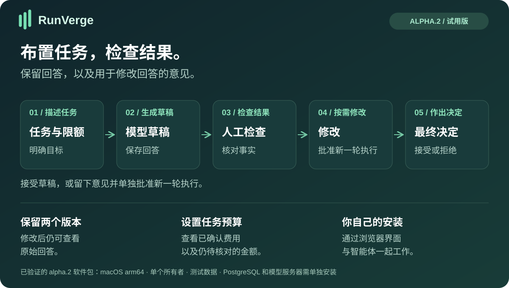
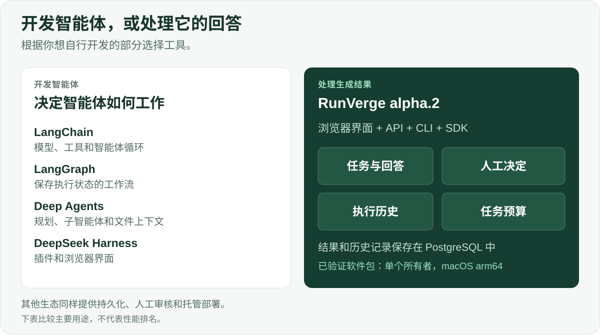
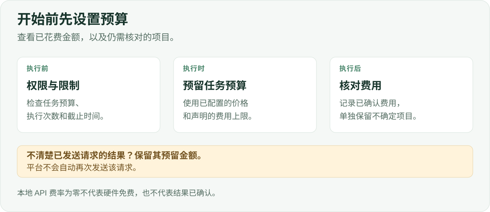

# RunVerge

**向智能体布置任务，检查回答，并保留修改历史。**

[English](README.md) · [Русский](README.ru.md) · [Español](README.es.md) · [Português (Brasil)](README.pt-BR.md) · [Deutsch](README.de.md) · [Français](README.fr.md) · [简体中文](README.zh-CN.md)

RunVerge 是一款与 AI 智能体协作的应用。你描述任务并设置预算，获得草稿，留下修改意见，再决定接受回答或批准新一轮执行。修改后仍可查看原始回答。

[**开始使用 →**](docs/QUICKSTART-ALPHA.md) · [**下载 alpha.2 →**](https://github.com/ArtAndrew/RunVerge/releases/tag/0.14.0-alpha.2) · [**第一个任务 →**](examples/alpha-first-task.md) · [**反馈 →**](https://github.com/ArtAndrew/RunVerge/issues/new/choose)

> **实验性 alpha.2：** macOS arm64、单个本地所有者、仅限测试数据。PostgreSQL 18 和本地模型服务器（如 Ollama）需单独配置。本版本不支持完整恢复、现有安装的升级或面向整个组织的生产部署。[支持范围](docs/SUPPORT.md)。

## RunVerge 安装在哪里，使用什么模型？

RunVerge 和模型是独立的服务。RunVerge 保存任务和结果，模型接收请求并生成回答。引擎已包含可由管理员配置的 HTTPS Chat Completions 连接。

已发布的 alpha.2 软件包和指南在 macOS arm64 上使用本地模型验证。目前不包含 Windows/Linux 软件包，也不包含针对 OpenRouter、DeepSeek、Nebius Token Factory 和 Z.ai 的已验证即用配置。可配置 API 连接本身并不能证明与每个服务商兼容。

应用的安装主机和模型服务商可以分别选择。目前提供 Mac 软件包，并不意味着产品只能使用本地模型。

## 适合哪些人？

| 用户 | 需求 | 现在可以尝试什么 |
|---|---|---|
| AI 应用开发者 | 为智能体工作配套审核流程 | 创建智能体和任务，通过界面、API 或 SDK 查看草稿和执行记录 |
| 技术负责人 | 了解生成了什么、作出了什么决定 | 跟踪原始材料、反馈、人工决策和费用状态 |
| 有开发者协助的早期用户 | 根据给定事实起草短文档 | 总结文本、起草说明或比较选项，再检查和修改结果 |

Alpha 安装仅支持**一个所有者**。上述用户类型不代表已经支持多人共享服务。

## 实际优势

- **完整的操作流程：** 在一个应用中完成任务、草稿、反馈、接受或拒绝。
- **保留历史：** 各轮执行分别保留材料，修改不会覆盖原始结果。
- **明确控制修改：** 请求修改会暂停任务；新一轮执行需要单独确认费用。
- **区分费用状态：** 预留金额、已确认费用和结果不确定的操作分别记录。
- **本地模型：** 可在不使用付费模型 API 的情况下体验流程；硬件和电力仍有成本。
- **便于集成：** API、CLI、Python SDK 和 TypeScript SDK 使用一致的公开契约。

如果你需要带有已保存草稿、审核决定和费用记录的任务页面，可以使用 RunVerge。通用智能体 harness 是另一种起点，它更侧重让你自行控制智能体的行为。

## 与其他工具的区别

| 项目 | 主要侧重点 | 适用情况 |
|---|---|---|
| [LangChain](https://docs.langchain.com/oss/python/langchain/overview) | 模型、工具、中间件和智能体循环 | 希望在自己的应用中组合智能体行为 |
| [LangGraph](https://docs.langchain.com/oss/python/langgraph/overview) | 有状态编排、持久执行和人工干预 | 需要结合确定性代码步骤与模型步骤的自定义图 |
| [Deep Agents](https://docs.langchain.com/oss/python/deepagents/overview) | 规划、子智能体、文件上下文和记忆 | 需要这些能力作为智能体的构建基础 |
| [DeepSeek Harness](https://github.com/deepseek-ai/deepseek-harness) | 带 Web 界面的可扩展插件式 harness | 希望通过插件定制 harness |
| **RunVerge alpha.2** | **本地任务与审核应用** | **希望以单个所有者和测试数据评估这一流程** |

以上内容依据链接中的官方介绍，于 2026 年 10 月 28 日核对。比较的是使用起点，并非断言其他项目缺少某项功能。LangGraph 和 Deep Agents 同样支持持久化与人工干预；LangChain 生态也提供托管部署产品。目前没有比较证据表明 RunVerge 在回答质量、速度、安全性或总成本方面优于这些产品。

## 执行与费用控制

任务预算、执行次数上限和截止时间限制新工作的准入，并不保证文本事实准确，也不保证服务商的最终账单。已发送操作结果不确定时，其预留金额会保留，不会盲目重试。本地 API 费率为零不代表 CPU/GPU、电力或折旧成本为零，也不会使付费工具免费。

**MCP：** 提供受限的[文本读取示例](docs/MCP-READ.md)，采用受信任配置、权限检查和执行批准。任意服务器、OAuth 和通用连接器市场不属于 alpha.2。

## 如何体验

1. 按照[快速开始](docs/QUICKSTART-ALPHA.md)安装软件包，并配置 PostgreSQL 和模型。
2. 使用包含五条示例事实的[第一个任务](examples/alpha-first-task.md)。
3. 检查草稿，记录修改意见，再单独批准新一轮执行。
4. 查看两个材料并决定接受什么结果。欢迎告诉我们你是否愿意带着第二个任务回来。

**Alpha.1 界面仅支持英语和俄语。** README 的七种语言不代表界面支持七种语言。切换界面语言会保留连接和当前工作，不会翻译任务或模型回答。[语言说明](docs/LANGUAGES.md)。

## 当前限制与文档

发布流程已由智能体检查，尚待新用户独立试用。小型本地模型可能遗漏事实或截断回答，请在平台之外保存重要结果。

完整恢复、升级、团队使用、企业 SSO 完整生命周期、云服务商部署、任意 MCP 集成以及生产性能尚不属于 alpha.2 已验收范围。不要将其作为公开的多用户服务。暂不提供双版本并排比较；请根据 ID 和创建时间区分材料。

软件包和 SHA-256 位于 [Releases](https://github.com/ArtAndrew/RunVerge/releases)。目前没有发布者签名；校验和只能核对文件是否与公布值一致，不能证明发布者身份。

- [安装](docs/NATIVE-BUNDLE.md) · [本地模型](docs/LOCAL-MODELS.md) · [MCP](docs/MCP-READ.md)
- [发布说明](docs/RELEASE-NOTES-alpha.2.md) · [支持范围](docs/SUPPORT.md) · [验证](docs/VALIDATION-alpha.1.md)
- [开发](docs/DEVELOPMENT.md) · [API 契约](contracts/README.md) · [公开内容](docs/PUBLIC-SOURCE.md)

[提交反馈](https://github.com/ArtAndrew/RunVerge/issues/new/choose)时，请提供系统、版本和遇到困难的步骤。不要附带令牌、私有配置、数据库连接字符串或私有文档。链接中的详细指南可能使用英语或俄语。

## 技术与许可

服务端和 worker 使用 Go，状态存储使用 PostgreSQL，Workspace 使用 React/TypeScript，SDK 支持 Python 和 TypeScript。CLI 命令仍为 `platform`，内部模块名保留为 `agent-platform`。

服务端、CLI、Web 应用、文档和图表使用 [Elastic License 2.0](LICENSE)；SDK 和示例按照各自附带的 Apache-2.0 许可证发布。依赖项保留原有许可。ELv2 属于源码可用许可，不是 OSI 认可的开源许可证。[许可边界](docs/LICENSING.md)。
